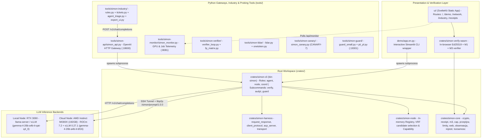
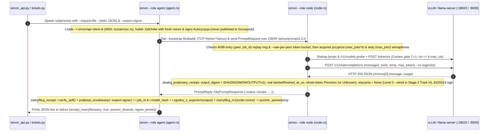
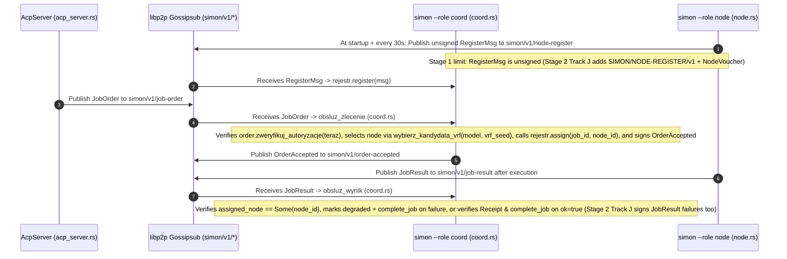
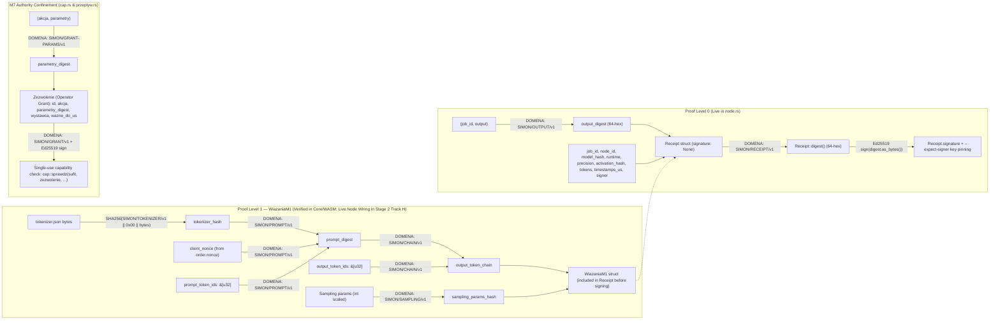

# 01 — Architecture Overview & Data Flows

This document maps the **actual implemented architecture** of SIMON (`https://github.com/Szpili/SIMON`, baseline `1d71e6d` after Stage 1 merge & Captain review) as verified directly from the source code, separating what runs live in production from what exists as offline verifiers, Gossipsub coordination, or Stage 2/3 queued work (for the Stage 2/3 wave-annotated team brief, see [`08_TEAM_SYNC_ARCHITECTURE_AND_WAVE_BRIEF.md`](./08_TEAM_SYNC_ARCHITECTURE_AND_WAVE_BRIEF.md)).

---

## 1. High-Level Repository Topology

---

## 2. Critical Discovery: The "Two Disconnected Worlds" in the Network Layer

Reading `crates/simon-harness` alongside `crates/simon-cli` reveals that **two separate network protocols exist in the repo, and the live inference path does not route through the Gossipsub coordinator**:

### Flow A: The Actual Live Point-to-Point Flow (`agent.rs` $\leftrightarrow$ `node.rs`)
Used by `simon --role agent`, `simon-api`, `simon-industry`, and `demo/app.en.py`.
* **Bypasses Gossipsub and Coordinator completely.**
* Requires the client (`agent.rs`) to already know the exact Multiaddr and `PeerId` of the target worker node (`--bootstrap /ip4/.../tcp/9001/p2p/<peer_id>`).

### Flow B: The Gossipsub + Coordinator Flow (`acp_server.rs` & `coord.rs`)
Exists in `crates/simon-harness/src/client_protocol.rs`, `acp_server.rs`, and `crates/simon-cli/src/coord.rs`. Stage 1 (`Track E` + Captain commit `c1f8ef9`) wired `wybierz_kandydata_vrf`, `assign`, `complete_job`, and `TOPIC_JOB_RESULT` handling in `coord.rs`, while `JobResult` signing and `RegisterMsg` signing/vouching are queued for Stage 2 (`Track J`):

---

## 3. Cryptographic Data Structures & Domain Separation Flow

Every hash in `crates/simon-core` is computed via `content_digest<T>(&value)` (`crates/simon-core/src/lib.rs`), which runs `serde_json::to_string(value)`, hashes the UTF-8 bytes with SHA-256, and returns a 64-character lowercase hex string. Ed25519 signatures (`crates/simon-core/src/crypto.rs`) sign the **64-byte ASCII hex string** of the digest.

---

## 4. Intelligent Industry (Hackathon Track 1) Data Flow

Implemented in `tools/simon-industry/` (`rules.py`, `tickets.py`, `agent_triage.py`, `export_ui.py`) + `ui/src/routes/industry/+page.svelte`:

```mermaid
flowchart LR
    CSV["UCI AI4I 2020 Dataset: data/ai4i2020.csv (10,000 rows)"] --> Sample["tickets.py:sample() - 18 stratified rows (15 rule hits + 3 RNF misses)"]
    Sample --> Rules["rules.py:findings() - Deterministic physics rules: HDF, PWF, OSF, TWF + CHECKS catalog"]
    Rules -->|"No rule fired (3 rows)"| Skip["No LLM Call - No ticket issued (recorded as rules miss)"]
    Rules -->|"1+ rules fired (15 rows)"| Prompt["tickets.py:prompt() & agent_triage.py - Cleaned CSV IDs + derived W/Nm/K + rules"]
    Prompt -->|"Round-robin model selection"| API["simon_api.py (:18600) - POST /v1/chat/completions (--expect-signer)"]
    API -->|"gemma-4-26b-a4b-it-qat-q4_0"| N3090["Node 1: Local RTX 3090 (llama.cpp)"]
    API -->|"gemma-4-26b-a4b-it-bf16"| NMI300X["Node 2: AMD Instinct MI300X (ROCm 7.2 + vLLM 0.27.1)"]
    N3090 & NMI300X -->|"Signed Receipt + JSON Ticket / Tool Proposal"| Check["tickets.py:check() & agent_triage.py M7 Ceiling - Checks from rules.CHECKS catalog, evidence from rules, NFKC/Cf & 17-case stress_corpus.json"]
    Check --> Export["export_ui.py - Writes ui/src/lib/industry-run.json"]
    Export --> Browser["/industry SvelteKit Page - Runs simon-verify-wasm in browser + shows plant-listed node vs unknown node"]
```

---

## 5. Key Architectural Bottlenecks & Design Decisions

1. **Process-per-Request Overhead in `simon_api.py` (`tools/simon-api/simon_api.py`):**
   * For every HTTP `/v1/chat/completions` request, `simon_api.py` spawns a fresh OS process `simon --role agent ...`, which initializes a Tokio runtime, generates a libp2p Swarm, performs a fresh TCP + Noise + Yamux handshake to the node, sends one CBOR request, verifies the receipt (and `--expect-signer` when `node_id` is in `nodes.json`), and exits.
   * On localhost (`docs/AMD-MI300X-RESULTS.md`), this only adds **~14 ms** of median latency (`3.93s` vs `3.92s`), because Rust startup + loopback TCP/Noise handshake is fast. Over WAN (`~124 ms` RTT to MI300X), the extra TCP+Noise handshake adds ~2–3 RTTs per request.
2. **Whole-Job Buffering vs. Token Streaming (`crates/simon-cli/src/node.rs`):**
   * Because a node cannot sign `output_digest` until the entire output string `output` is known, `node.rs` calls `/v1/chat/completions` with non-streaming JSON, waits for completion, signs the receipt, and sends a single `PromptResponse` over libp2p.
   * Consequently, `simon_api.py:_stream` sends `: simon job running` SSE keepalive comments every 5s while waiting, and then emits the response + receipt in one burst at the end ("streaming after the fact").
3. **Why Map-Reduce (`mapreduce.rs`) Works While Model Sharding Failed:**
   * Splitting model layers (pipeline parallelism) or MoE experts across WAN requires tens of synchronization barriers *per generated token* (measured 12× to 55× slowdown in `docs/AMD-MI300X-RESULTS.md`).
   * By contrast, `crates/simon-cli/src/mapreduce.rs` and `agent.rs` keep whole models on each node and split **long input documents** into UTF-8 safe chunks with automatic context-limit halving (`wyslij_kawalek_z_retry` on `ctx_ponad_limit`), producing an independent signed receipt for every Map and Reduce step.
