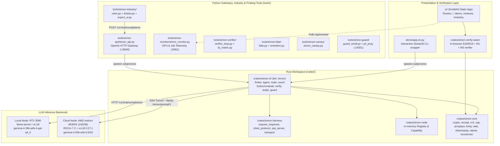
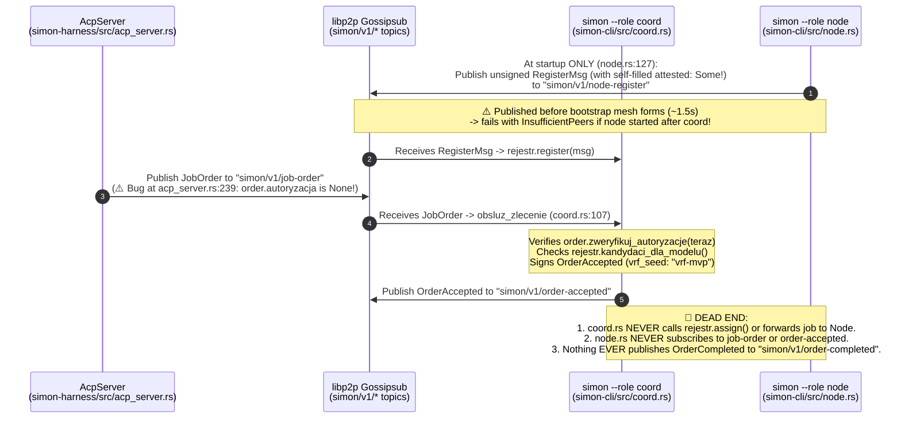
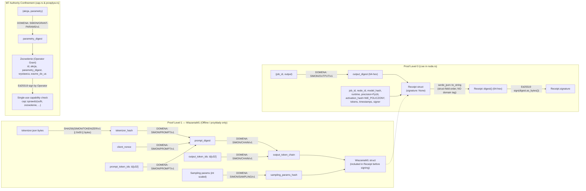

# 01 — Architecture Overview & Data Flows

This document maps the **actual implemented architecture** of SIMON (`https://github.com/Szpili/SIMON`) as verified directly from the source code, separating what runs live in production from what exists only as disconnected library primitives or offline scripts.

---

## 1. High-Level Repository Topology



---

## 2. Critical Discovery: The "Two Disconnected Worlds" in the Network Layer

Reading `crates/simon-harness` alongside `crates/simon-cli` reveals that **two completely separate network protocols exist in the repo, and they are NOT connected to each other**:

### Flow A: The Actual Live Point-to-Point Flow (`agent.rs` $\leftrightarrow$ `node.rs`)
Used by `simon --role agent`, `simon-api`, `simon-industry`, and `demo/app.en.py`.
* **Bypasses Gossipsub and Coordinator completely.**
* Requires the client (`agent.rs`) to already know the exact Multiaddr and `PeerId` of the target worker node (`--bootstrap /ip4/.../tcp/9001/p2p/<peer_id>`).

```mermaid
sequenceDiagram
    autonumber
    participant Py as simon_api.py / tickets.py
    participant Agent as simon --role agent<br/>(crates/simon-cli/src/agent.rs)
    participant Node as simon --role node<br/>(crates/simon-cli/src/node.rs)
    participant LLM as vLLM / llama-server<br/>(HTTP :18020 / :8000)

    Py->>Agent: Spawn subprocess with --request-file - (stdin JSON)
    Note over Agent: Loads ~/.simon/api-client.id (tozsamosc.rs)<br/>Builds JobOrder + signs Autoryzacja (agent.rs:460-492)<br/>⚠️ THROWS JobOrder AWAY (never published to Gossipsub!)
    Agent->>Node: Dial --bootstrap Multiaddr (TCP+Noise+Yamux)<br/>Send PromptRequest over CBOR /simon/prompt/1
    Note over Node: Acquires przyjecia semaphore (max_jobs * 4)<br/>Spawns task -> acquires sloty semaphore (max_jobs)
    Node->>LLM: POST /tokenize {"prompt": req.prompt}<br/>(Context gate: checks ctx <= b.max_ctx)
    Note over Node,LLM: ⚠️ On llama-server, /tokenize expects {"content":...}<br/>so this fails & falls back to agent's char estimate!
    Node->>LLM: POST /v1/chat/completions<br/>(messages, tools, temp, max_tokens; NO logprobs!)
    LLM-->>Node: HTTP 200 JSON (choices[0].message, usage)
    Note over Node: zbuduj_podpisany_receipt (node.rs:710-755):<br/>- output_digest = SHA256("SIMON/OUTPUT/v1" || job_id || output)<br/>- precision = Fp16 (HARDCODED)<br/>- activation_hash = "toploc:NIE_POLICZONY" (HARDCODED)<br/>- wiazania = None (Proof Level 0)<br/>- started_at_us = teraz, finished_at_us = teraz (0 µs!)<br/>- Ed25519 sign(digest_hex)
    Node-->>Agent: PromptReply::Ok(PromptResponse { output, receipt, ... })
    Note over Agent: zweryfikuj_receipt (agent.rs:729-751):<br/>- Calls r.verify_self() (⚠️ does NOT check node pubkey!)<br/>- Checks r.job_id & r.model_hash<br/>- Checks r.zgodny_z_wyjsciem(output)<br/>- Signs ClientObservationV1 & appends RekordPracyV1
    Agent-->>Py: Prints JSON line to stdout (receipt_zweryfikowany: true)
```

### Flow B: The Unfinished Gossipsub + Coordinator Flow (`acp_server.rs` & `coord.rs`)
Exists in `crates/simon-harness/src/client_protocol.rs`, `acp_server.rs`, and `crates/simon-cli/src/coord.rs`, **but stops dead before any job reaches a node**:



---

## 3. Cryptographic Data Structures & Domain Separation Flow

Every hash in `crates/simon-core` is computed via `content_digest<T>(&value)` (`crates/simon-core/src/lib.rs:67-74`), which runs `serde_json::to_string(value)`, hashes the UTF-8 bytes with SHA-256, and returns a 64-character lowercase hex string. Ed25519 signatures (`crates/simon-core/src/crypto.rs:53-55`) sign the **64-byte ASCII hex string** of the digest.



---

## 4. Intelligent Industry (Hackathon Track 1) Data Flow

Added on Oct 15 (`tools/simon-industry/` + `ui/src/routes/industry/+page.svelte`):

```mermaid
flowchart LR
    CSV["UCI AI4I 2020 Dataset<br/>data/ai4i2020.csv (10,000 rows)"] --> Sample["tickets.py:sample()<br/>18 stratified rows<br/>(15 rule hits + 3 RNF misses)"]
    Sample --> Rules["rules.py:findings()<br/>Deterministic physics rules:<br/>HDF, PWF, OSF, TWF"]
    Rules -->|"No rule fired (3 rows)"| Skip["No LLM Call<br/>No ticket issued"]
    Rules -->|"1+ rules fired (15 rows)"| Prompt["tickets.py:prompt()<br/>Telemetry + derived W/Nm/K + rules"]
    Prompt -->|"Round-robin model selection"| API["simon_api.py (:18600)<br/>POST /v1/chat/completions"]
    API -->|"gemma-4-26b-a4b-it-qat-q4_0"| N3090["Node 1: Local RTX 3090<br/>(llama.cpp)"]
    API -->|"gemma-4-26b-a4b-it-bf16"| NMI300X["Node 2: AMD Instinct MI300X<br/>(ROCm 7.2 + vLLM 0.27.1)"]
    N3090 & NMI300X -->|"Signed Receipt + JSON Ticket"| Check["tickets.py:check()<br/>1. Valid 7-key JSON schema<br/>2. failure_modes == rule codes<br/>3. urgency == max rule urgency<br/>4. needs_human_review == True<br/>5. No hallucinated numbers (>10)<br/>6. No FORBIDDEN shutdown verbs"]
    Check --> Export["export_ui.py<br/>Writes ui/src/lib/industry-run.json"]
    Export --> Browser["/industry SvelteKit Page<br/>Runs simon-verify-wasm in browser<br/>on all 15 receipts + signed_output"]
```



---

## 5. Key Architectural Bottlenecks & Design Decisions

1. **Process-per-Request Overhead in `simon_api.py` (`tools/simon-api/simon_api.py:76-91`):**
   * For every HTTP `/v1/chat/completions` request, `simon_api.py` spawns a fresh OS process `simon --role agent ...`, which initializes a Tokio runtime, generates a libp2p Swarm, performs a fresh TCP + Noise + Yamux handshake to the node, sends one CBOR request, verifies the receipt, and exits.
   * Surprisingly, on localhost (`docs/AMD-MI300X-RESULTS.md:128-174`), this only adds **~14 ms** of median latency (`3.929s` vs `3.915s`), because Rust startup + loopback TCP/Noise handshake is fast. Over WAN (`~47 ms` RTT to MI300X), the extra TCP+Noise handshake adds ~2–3 RTTs (~100–140 ms) per request.
2. **Whole-Job Buffering vs. Token Streaming (`crates/simon-cli/src/node.rs:297-402`):**
   * Because a node cannot sign `output_digest` until the entire output string `output` is known, `node.rs` calls `/v1/chat/completions` with non-streaming JSON, waits for completion, signs the receipt, and sends a single `PromptResponse` over libp2p.
   * Consequently, `simon_api.py:_stream` (`lines 207-249`) sends `: simon job running` SSE keepalive comments every 5s while waiting, and then dumps the entire response + receipt in one burst at the end ("streaming after the fact").
3. **Why Map-Reduce (`mapreduce.rs`) Works While Model Sharding Failed:**
   * Splitting model layers (pipeline parallelism) or MoE experts across WAN requires tens of synchronization barriers *per generated token* (measured 12× to 55× slowdown in `docs/AMD-MI300X-RESULTS.md`).
   * By contrast, `crates/simon-cli/src/mapreduce.rs` and `agent.rs:251-454` keep whole models on each node and split **long input documents** into UTF-8 safe chunks with automatic context-limit halving (`wyslij_kawalek_z_retry` on `ctx_ponad_limit`), producing an independent signed receipt for every Map and Reduce step.
