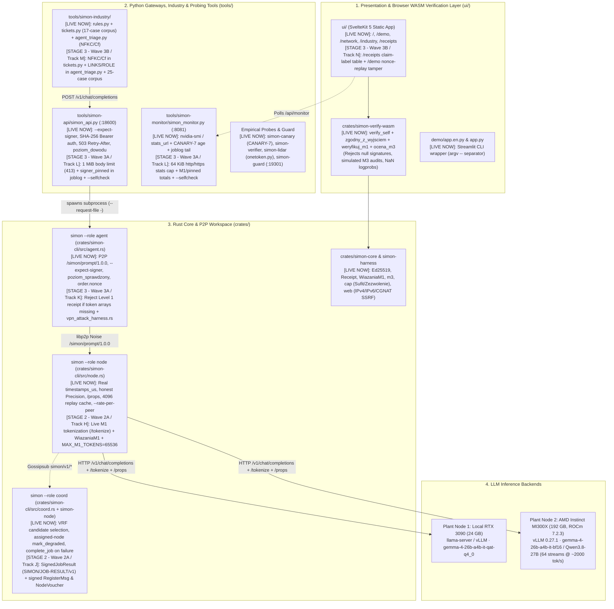
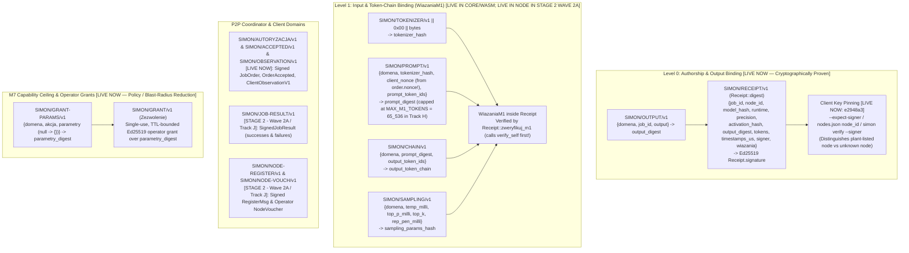
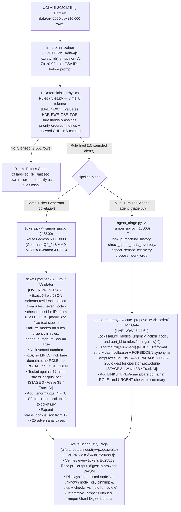

# 01 — SIMON Architecture, Data Flows & Stage/Wave Evolution Map (Team Sync Brief)

**Baseline Commit (`fz-contrib`):** `1d71e6d` (merges `upstream/main` `5854038` + `upstream/fz-contrib` `53854d2` — post-Stage 1 Captain & Claude Opus 5.5 review)  
**Purpose:** Single-document executive and technical briefing for the hackathon team call. Grounded 100% in the actual source code, this document separates:
* `[LIVE NOW — Post-Stage 1 (1d71e6d)]` — What is currently implemented, tested, and running in the repository right now.
* `[STAGE 2 — Wave 2A (Tracks H, J)]` — Urgent protocol & security closing items from the Captain's [`docs/STRESS-TESTS.md`](file:///home/agent/SIMON/docs/STRESS-TESTS.md) `## Next` list (`#1` Signed `JobResult`, `#2` Live M1 token binding with `MAX_M1_TOKENS`, `#3` Signed `RegisterMsg` + operator vouching + Sybil tests).
* `[STAGE 2 — Wave 2B (Tracks G, I)]` — Upstream `docs/ARCHITECTURE.md`, `STRESS-TESTS.md` rows 7/17/18 update, and one-command Captain verification gate (`scripts/verify_all_fast.sh` + cherry-pick menu).
* `[STAGE 3 — Wave 3A (Tracks K, L)]` — `STRESS-TESTS.md` `Next #4` prepared VPN target network attack harness (`vpn_attack_harness.rs`), client M1 missing-token gate, and `simon_api.py` / `simon_monitor.py` hardening.
* `[STAGE 3 — Wave 3B (Tracks M, N)]` — Industry NFKC/link/role guardrail parity across `tickets.py` & `agent_triage.py` (`stress_corpus.json` expanded 17 $\rightarrow$ 25 cases) and UI `/receipts` + `/demo` polish.

---

## 1. Executive 60-Second Brief for the Team Call

### 1.1 Strategic Framing & Deployment Boundary
Following the Oct 15–16 team call and Captain review ([`docs/THREAT-MODEL.md`](file:///home/agent/SIMON/docs/THREAT-MODEL.md), [`docs/STRESS-TESTS.md`](file:///home/agent/SIMON/docs/STRESS-TESTS.md)):
1. **What SIMON Is:** A **verifiable inference-result publication** layer (cryptographic non-repudiation of *who* signed *which* output for *which* input and *which declared* model/parameters), combined with deterministic **policy/capability ceilings (M7)** and empirical **canary/drift probes (M3, `CANARY-7`, verifier pilot)**. It is **not** a cryptographic proof of model execution (which requires a hardware TEE).
2. **Primary Target Deployment:** A **company or machining plant running SIMON across ~5 machines inside its own VPN**, where one participant (an employee, a compromised GPU node, or a gateway) may turn dishonest or suffer silent hardware weight corruption (e.g., consumer RTX 3090 without ECC memory).

### 1.2 Current Codebase vs. Stage 2 & Stage 3 Wave Matrix

| Architectural Subsystem | `[LIVE NOW — Post-Stage 1 (1d71e6d)]` (Already in Repo) | `[STAGE 2 — Waves 2A & 2B]` (Next Up — Priority 1) | `[STAGE 3 — Waves 3A & 3B]` (If Time Permits — Priority 2) |
| :--- | :--- | :--- | :--- |
| **1. Point-to-Point Inference & Receipts (`node.rs` $\leftrightarrow$ `agent.rs`)** | • Real `started_at_us`/`finished_at_us` timestamps • Honest `Precision::{Fp16, Bf16, Fp8, Fp4, Int8, Int4, Unknown}` (no guessing) • `llama.cpp` `/props` & `/tokenize` support • Per-peer replay cache (`4096` jobs) & token-bucket rate limiter (`--rate-per-peer 16/s`) • Key pinning (`--expect-signer`, `signer_pinned`) • **Gap:** Live node still emits **Level 0** receipts (`wiazania: None`) | **`[Wave 2A — Track H]`** (`STRESS-TESTS.md` Next #2): • `node.rs` calls `wspolne::tokenizuj_tekst` on prompt & output, builds `WiazaniaM1` (**Live Proof Level 1**), and returns token IDs in `PromptResponse` • Enforces `MAX_M1_TOKENS = 65_536` cap on both `/tokenize` and `zweryfikuj_m1` • Adds in-process `e2e_m1_receipt.rs` test | **`[Wave 3A — Track K]`** (`STRESS-TESTS.md` Next #4): • Fixes `agent.rs::zweryfikuj_receipt` so a receipt claiming Level 1 (`poziom() >= 1`) without token arrays (`m1.is_none()`) is **rejected** instead of silently passing as Level 0 • Populates `prompt_commitment` & `tokenizer_manifest_hash` in `RekordPracyV1` |
| **2. P2P Coordinator, Gossipsub & Node Registry (`coord.rs`, `simon-node`)** | • `Registry::wybierz_kandydata_vrf` deterministic SHA-256 selection • `coord.rs` subscribes to `TOPIC_JOB_RESULT`, checks `assigned_node == Some(node_id)` before `mark_degraded`, and calls `complete_job` on failure • **Gap 1:** `JobResult` on gossip is **unsigned** (anyone who knows `(job_id, node_id)` can forge a failure) • **Gap 2:** `RegisterMsg` on gossip is **unsigned** (Sybil nodes can flood `Registry`) | **`[Wave 2A — Track J]`** (`STRESS-TESTS.md` Next #1 & #3): • Adds `SignedJobResult` (`SIMON/JOB-RESULT/v1`, Ed25519-signed by node key for **both successes and failures**) • Adds Ed25519 signature (`SIMON/NODE-REGISTER/v1`) + optional `NodeVoucher` (`SIMON/NODE-VOUCH/v1`) to `RegisterMsg` • Coordinator flags `--node-key` & `--require-voucher` + Sybil flood test | **`[Wave 3A — Track K]`** (`STRESS-TESTS.md` Next #4): • Adds `crates/simon-cli/tests/vpn_attack_harness.rs`: spins up an in-process target network and runs 7 automated red-team attacks mapped to `STRESS-TESTS.md` rows 1–7, 17, 18 |
| **3. OpenAI HTTP Gateway & Network Monitor (`simon-api`, `simon-monitor`)** | • `simon_api.py` passes `--expect-signer` from `nodes.json`, checks `SIMON_API_KEY` via SHA-256 `hmac.compare_digest`, returns `503` + `Retry-After: 5` on `node_zajety`/`rate_limit`, and reports `proof_level` from `poziom_sprawdzony` • `simon_monitor.py` tracks GPU stats, `CANARY-7` age, and per-node jobs | **`[Wave 2B — Track I]`**: • Adds `scripts/verify_all_fast.sh` running all Rust tests, Clippy `--all-targets`, Python `.selfcheck()` suites, and guardrail greps in <30s | **`[Wave 3A — Track L]`**: • Enforces `MAX_BODY_BYTES = 1 MiB` (`413`) in `simon_api.py` (blocks memory DoS) & logs `signer_pinned` to `SIMON_API_JOBLOG` • Bounds `fetch_stats` in `simon_monitor.py` (`http/https` only, 64 KiB max) & tracks `verified_m1_jobs` / `pinned_jobs` |
| **4. Track 1 Intelligent Industry (`tools/simon-industry/`)** | • `rules.py` deterministic physics rules (`8 ms`, 0 tokens) + per-mode `CHECKS` catalog • `tickets.py` checks step IDs against `rules.CHECKS`, strips model `evidence`, checks 17-case `stress_corpus.json` • `agent_triage.py` locks `failure_modes`, `urgency`, `action_code`, `part_id` to `rules.findings(row)[0]`, normalizes Unicode (`NFKC` + `Cf` strip + dashes), and cleans CSV IDs • **Gap:** `tickets.py` lacks `_znormalizuj` (`NFKC`/`Cf`), and `agent_triage.py` lacks `tickets.py`'s `LINKS` / `ROLE` / `URGENT` checks | **`[Wave 2B — Track G]`**: • Documents the end-to-end Industry + M7 pipeline and claim hierarchy in `docs/ARCHITECTURE.md` | **`[Wave 3B — Track M]`**: • Applies `_znormalizuj` (`NFKC` + `Cf` strip + dash collapse) to `tickets.py` • Adds `LINKS` (including bare domains), `ROLE`, and `URGENT` checks to `agent_triage.py` • Expands `stress_corpus.json` from **17 $\rightarrow$ 25 cases** |
| **5. Web UI (`ui/`) & Documentation (`docs/`)** | • Routes: `/`, `/demo`, `/network`, `/industry`, and new `/receipts` (`What a receipt proves`) • `/industry` shows `plant-listed node` vs `unknown node` + `rules + checks` vs `held for review` • 390px mobile overflow fixed + `type="button"` / `aria-pressed` on `NodePanel` & `VerifierPanel` | **`[Wave 2B — Track G & Track I]`**: • Creates `docs/ARCHITECTURE.md` & `docs/FZ-CONTRIB-CHERRY-PICK-GUIDE.md` • Updates `docs/STRESS-TESTS.md` rows 7, 17, 18 & `## Honest limits` | **`[Wave 3B — Track N]`**: • Adds Level 0 / Level 1 / M3 / M7 claim-label reference table to `/receipts` • Adds **Tamper Client Nonce (Replay Attack)** button (`STRESS-TESTS.md` Row 4) + `aria-pressed` semantics to `/demo` |

---

## 2. High-Level System Topology (Current State + Stage 2/3 Overlays)

---

## 3. Data Flow A: Point-to-Point Inference & Receipt Pipeline (`simon_api.py` $\leftrightarrow$ `agent.rs` $\leftrightarrow$ `node.rs`)

This is the **primary production path** used by `simon --role agent`, `tools/simon-api/simon_api.py`, `tools/simon-industry/tickets.py`, and `tools/simon-industry/agent_triage.py`.

### 3.1 Sequence Diagram (Current `[LIVE NOW]` vs `[STAGE 2 — Wave 2A]` & `[STAGE 3 — Wave 3A]`)

```mermaid
sequenceDiagram
    autonumber
    participant Client as simon_api.py / tickets.py
    participant Agent as simon --role agent<br/>(crates/simon-cli/src/agent.rs)
    participant Node as simon --role node<br/>(crates/simon-cli/src/node.rs)
    participant LLM as vLLM / llama-server<br/>(HTTP :8000 / :18020)

    Client->>Agent: Spawn with --request-file - (stdin JSON)<br/>+ --expect-signer <node_id> [LIVE NOW: e2948a3]
    Note over Client: [STAGE 3 - Wave 3A / Track L]:<br/>Enforce MAX_BODY_BYTES = 1 MiB (HTTP 413) before reading request
    Note over Agent: 1. Load 0600 identity (~/.simon/api-client.id)<br/>2. Build JobOrder with fresh 128-bit nonce & sign Autoryzacja
    Agent->>Node: Dial --bootstrap Multiaddr over libp2p (TCP + Noise + Yamux)<br/>Send PromptRequest (CBOR /simon/prompt/1.0.0)

    Note over Node: [LIVE NOW: c1f8ef9] Per-Peer Admission Gate:<br/>1. Check (peer, job_id) against 4096-entry replay ring -> reject "powtorzony_job"<br/>2. Check token bucket (--rate-per-peer 16/s, 4s burst) -> reject "rate_limit"<br/>3. Acquire przyjecia (max_jobs*4) & sloty (max_jobs) semaphores

    Node->>LLM: Startup / cached probe: GET /v1/models & GET /props<br/>[LIVE NOW: 40e0d53] Detect vLLM vs llama.cpp runtime & whole-token Precision
    Node->>LLM: POST /tokenize ({"prompt": ...} or {"content": ...})<br/>Context gate C+1: reject "ctx_ponad_limit" if realny_ctx > max_ctx

    Node->>LLM: POST /v1/chat/completions (messages, tools, temp, max_tokens)
    LLM-->>Node: HTTP 200 JSON (choices[0].message, usage,started/finished_at_us)

    rect rgb(30, 55, 40)
        Note over Node,LLM: [STAGE 2 - Wave 2A / Track H] (STRESS-TESTS.md Next #2 — Live M1 Wiring):<br/>1. Call wspolne::tokenizuj_tekst(b, req.prompt) -> prompt_token_ids (capped at MAX_M1_TOKENS = 65_536)<br/>2. Call wspolne::tokenizuj_tekst(b, output) -> output_token_ids (capped at MAX_M1_TOKENS = 65_536)<br/>3. Attach Receipt::z_wiazaniem_m1(tokenizer_hash, req.nonce, &p_ids, &o_ids, ...) BEFORE .sign(&klucz)
    end

    Node-->>Agent: PromptReply::Ok(PromptResponse { output, receipt,<br/>tokenizer_hash, prompt_token_ids, output_token_ids })

    Note over Agent: Client-Side Verification (agent.rs::zweryfikuj_receipt):<br/>1. [LIVE NOW] r.verify_self() (Ed25519 signature over canonical Receipt JSON)<br/>2. [LIVE NOW] podpisal_oczekiwany(receipt, --expect-signer) (Key Pinning)<br/>3. [LIVE NOW] r.job_id == expected && r.model_hash == expected<br/>4. [LIVE NOW] r.zgodny_z_wyjsciem(output) (SIMON/OUTPUT/v1 digest)<br/>5. [LIVE NOW: ca62c72] If M1 tokens present, r.zweryfikuj_m1(tok_hash, order.nonce, p_ids, o_ids)<br/>6. [LIVE NOW: e621d39] poziom_dowodu = poziom_sprawdzony(ok, m1_checked, r.poziom())<br/>7. [STAGE 3 - Wave 3A / Track K] Reject if r.poziom() >= 1 but M1 token arrays are missing!

    Agent-->>Client: Stdout JSON (ok, output, receipt, poziom_dowodu, signer_pinned)
```

---

## 4. Data Flow B: Gossipsub Coordinator & Node Registry (`coord.rs` & `simon-node`)

In `crates/simon-node/src/lib.rs` and `crates/simon-cli/src/coord.rs`, SIMON implements a Gossipsub-based coordinator (`simon --role coord`) that maintains a `Registry` of nodes, selects candidates via deterministic VRF (`wybierz_kandydata_vrf`), and tracks node health via `TOPIC_JOB_RESULT`.

### 4.1 What Changed in Stage 1 vs What Lands in `[STAGE 2 — Wave 2A / Track J]`

During Stage 1 review (`c1f8ef9`, `53854d2`), the Captain fixed `coord.rs` so that an unassigned `JobResult` cannot degrade a healthy node and ensured `complete_job` is called on failure, **but explicitly noted two remaining security limits in [`docs/STRESS-TESTS.md`](file:///home/agent/SIMON/docs/STRESS-TESTS.md#L27-L50)**:
1. **Row 7 & Next #1 (Unsigned `JobResult`):** `JobResult` (`{job_id, node_id, ok, receipt, blad}`) is currently unsigned, and failed jobs have `receipt: None`. Any peer on the VPN who observes a fresh `(job_id, node_id)` assignment on `TOPIC_ORDER_ACCEPTED` can broadcast `JobResult { ok: false, receipt: None }` to `TOPIC_JOB_RESULT` and mark the honest node `Degraded`.
2. **Honest Limits & Next #3 (Unsigned Node Registration / Sybil):** `RegisterMsg` on `TOPIC_NODE_REGISTER` carries no Ed25519 signature and no operator voucher, allowing a Sybil attacker to register arbitrary fake `node_id`s or overwrite an honest node's `RegisterMsg`.

**Both gaps are closed in `[STAGE 2 — Wave 2A / Track J]`:**

```mermaid
sequenceDiagram
    autonumber
    participant Op as Plant Operator Key<br/>(--trusted-voucher)
    participant Node as simon --role node<br/>(crates/simon-cli/src/node.rs)
    participant Gossip as libp2p Gossipsub<br/>(simon/v1/* topics)
    participant Coord as simon --role coord<br/>(crates/simon-cli/src/coord.rs)

    rect rgb(30, 45, 65)
        Note over Op,Coord: [STAGE 2 - Wave 2A / Track J] (STRESS-TESTS.md Next #3 — Signed Registration & Vouching)
        Op->>Node: Optional offline/config NodeVoucher signed under "SIMON/NODE-VOUCH/v1"
        Node->>Gossip: Publish signed RegisterMsg ("SIMON/NODE-REGISTER/v1")<br/>with node_pubkey, timestamp_us, signature, voucher
        Gossip->>Coord: obsluz_rejestracje(dane)
        Note over Coord: 1. Verify RegisterMsg::verify_signature() (node owns node_id)<br/>2. If --require-voucher, verify msg.verify_voucher(&trusted_vouchers)<br/>3. Reject Sybil / unsigned / unvouched nodes before Registry::register()
    end

    Gossip->>Coord: JobOrder on "simon/v1/job-order"
    Note over Coord: [LIVE NOW] Verify order.zweryfikuj_autoryzacje(teraz)<br/>Select node via wybierz_kandydata_vrf(model, vrf_seed)<br/>Record rejestr.assign(job_id, winner.node_id)
    Coord->>Gossip: Publish signed OrderAccepted to "simon/v1/order-accepted"

    rect rgb(30, 55, 40)
        Note over Node,Coord: [STAGE 2 - Wave 2A / Track J] (STRESS-TESTS.md Next #1 — SignedJobResult)
        Node->>Gossip: Publish SignedJobResult ("SIMON/JOB-RESULT/v1")<br/>(Ed25519-signed by node key over {domena, job_id, node_id, ok, receipt_digest, blad, timestamp_us})
        Gossip->>Coord: obsluz_wynik(dane)
        Note over Coord: 1. Look up assigned_node = rejestr.assigned_node(job_id)<br/>2. Look up expected_pubkey for assigned_node (--node-key or registered pubkey)<br/>3. Verify SignedJobResult::verify(&expected_pubkey)<br/>4. If ok=true, also verify Receipt::verify_self() & signer == expected_pubkey<br/>5. Only after valid signature: complete_job(job_id) (or mark_degraded + complete_job on signed failure)
    end
```

---

## 5. Cryptographic Domain Tree & Verification Hierarchy (`simon-core` & `simon-verify-wasm`)

All domain-separated SHA-256 commitments in SIMON use `content_digest<T>` (`serde_json::to_string` $\rightarrow$ SHA-256 $\rightarrow$ 64-char hex) with no floating-point numbers (`f32`/`f64` are forbidden in signed structs; timestamps are `u64` microseconds and temperatures/top-p are integer-scaled `u32`).

---

## 6. Track 1 Intelligent Industry Pipeline (`tools/simon-industry/` & `/industry` UI)

This pipeline powers the **Intelligent Industry** hackathon track, running Gemma 4 26B-A4B across the local RTX 3090 (`Q4_0`) and AMD Instinct MI300X (`BF16`) on the UCI AI4I 2020 milling dataset (`10,000` records).

---

## 7. Complete Stage 2 & Stage 3 Wave Roadmap (For Team Call Agenda)

All tracks branch off **`fz-contrib` (`1d71e6d`)** and open PRs targeting **`fz-contrib`** (never `main`), with atomic `[FZ-<Track><N>]` commits so the Team Captain (`Szpili`) can cherry-pick individual commits or merge `fz-contrib` in one click.

| Stage & Wave | Track | Tag | Branch (`-> fz-contrib`) | Exclusive Files Touched | Exact Deliverable & `STRESS-TESTS.md` Mapping |
| :--- | :--- | :--- | :--- | :--- | :--- |
| **Stage 2 — Wave 2A** *(Urgent Protocol & Security)* | **Track H** | `[FZ-H]` | `fz/track-H-e2e-integration-and-live-m1-bridge` | `crates/simon-cli/src/wspolne.rs` `crates/simon-cli/src/node.rs` `crates/simon-cli/tests/e2e_m1_receipt.rs` | **`STRESS-TESTS.md` Next #2:** Wires live M1 token chain in `node.rs` via `/tokenize`, enforces `MAX_M1_TOKENS = 65_536` cap in `wspolne.rs` & `node.rs`, and adds in-process E2E test (`e2e_m1_receipt.rs`). |
| **Stage 2 — Wave 2A** *(Urgent Protocol & Security)* | **Track J** | `[FZ-J]` | `fz/track-J-signed-job-result-and-registration` | `crates/simon-node/src/lib.rs` `crates/simon-cli/src/coord.rs` | **`STRESS-TESTS.md` Next #1 & #3:** Signs `JobResult` (`SIMON/JOB-RESULT/v1`, failures too) with node key; signs `RegisterMsg` (`SIMON/NODE-REGISTER/v1`) + `NodeVoucher` (`SIMON/NODE-VOUCH/v1`); adds Sybil flood tests. |
| **Stage 2 — Wave 2B** *(Docs & Captain Fast-Gate)* | **Track G** | `[FZ-G]` | `fz/track-G-architecture-and-docs-overhaul` | `docs/ARCHITECTURE.md` `docs/STRESS-TESTS.md` `docs/THREAT-MODEL.md` `ROADMAP.md` `docs/whitepaper/SIMON-whitepaper-EN.md` | Creates `docs/ARCHITECTURE.md` in upstream repo, updates `docs/STRESS-TESTS.md` rows 7/17/18 and `## Honest limits`, and aligns `THREAT-MODEL.md` & `ROADMAP.md`. |
| **Stage 2 — Wave 2B** *(Docs & Captain Fast-Gate)* | **Track I** | `[FZ-I]` | `fz/track-I-captain-cherry-pick-menu-and-ci` | `scripts/verify_all_fast.sh` `docs/FZ-CONTRIB-CHERRY-PICK-GUIDE.md` | Adds `<30s` full-stack verification & Captain guardrail script (`scripts/verify_all_fast.sh`) and generates `docs/FZ-CONTRIB-CHERRY-PICK-GUIDE.md`. |
| **Stage 3 — Wave 3A** *(Attack Harness & Gateway)* | **Track K** | `[FZ-K]` | `fz/track-K-vpn-attack-harness-and-agent-m1-gate` | `crates/simon-cli/src/agent.rs` `crates/simon-cli/tests/vpn_attack_harness.rs` | **`STRESS-TESTS.md` Next #4:** Prepared VPN target network attack harness (`vpn_attack_harness.rs`) reproducing rows 1–7, 17, 18 + fixes `agent.rs` to reject Level 1 receipts missing token arrays. |
| **Stage 3 — Wave 3A** *(Attack Harness & Gateway)* | **Track L** | `[FZ-L]` | `fz/track-L-gateway-and-monitor-hardening` | `tools/simon-api/simon_api.py` `tools/simon-api/test_gateway.py` `tools/simon-monitor/simon_monitor.py` | Enforces `1 MiB` HTTP body cap (`413`) and logs `signer_pinned` in `simon_api.py`; caps `fetch_stats` (`http/https`, 64 KiB) and tracks M1/pinned totals in `simon_monitor.py`; adds `--selfcheck` to both. |
| **Stage 3 — Wave 3B** *(Industry Corpus & UI)* | **Track M** | `[FZ-M]` | `fz/track-M-industry-adversarial-corpus` | `tools/simon-industry/tickets.py` `tools/simon-industry/agent_triage.py` `tools/simon-industry/stress_corpus.json` | Brings `tickets.py` and `agent_triage.py` to 100% guardrail parity (`_znormalizuj` NFKC + `Cf` strip in `tickets.py`; `LINKS`/`ROLE`/`URGENT` in `agent_triage.py`) and expands `stress_corpus.json` from 17 to 25 cases. |
| **Stage 3 — Wave 3B** *(Industry Corpus & UI)* | **Track N** | `[FZ-N]` | `fz/track-N-ui-receipts-and-demo-polish` | `ui/src/routes/receipts/+page.svelte` `ui/src/routes/demo/+page.svelte` | Adds Level 0 / Level 1 / M3 / M7 claim-label reference table to `/receipts` and adds client-nonce replay tamper preset (`STRESS-TESTS.md` Row 4) + `aria-pressed` semantics to `/demo`. |
