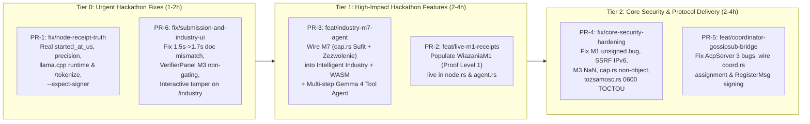

# 05 — Hackathon Roadmap & Feature-Branch / Pull-Request Catalog

**Current Date:** 2026-10-15  
**Hackathon Deadline:** AMD Developer Hackathon: ACT III (Oct 18, 2026)  
**Goal:** Maximize judging scores across **Track 1 (Intelligent Industry)**, **Google Gemma Prize ($5,000)**, **AMD Prize ($5,000)**, **Vibe Generation Special Prize**, and **Evolus Business Agents Partner Track**, while delivering the unimplemented/unwired core features discovered during the audit.

---

## 1. Strategic Prioritization Matrix

---

## 2. Detailed Pull Request (Feature Branch) Catalog

Each PR below is scoped to touch **disjoint or cleanly modularized file sets** so that **6 parallel Gemini 3.8 Flash High coding agents** can implement and test them simultaneously in isolated `git worktree` checkouts without merge conflicts.

| PR ID | Branch Name | Priority | Target Files | What It Solves / Delivers |
| :--- | :--- | :--- | :--- | :--- |
| **PR-1** | `fix/node-receipt-truth` | **Tier 0 (Urgent)** | `crates/simon-cli/src/node.rs` `crates/simon-cli/src/agent.rs` `crates/simon-cli/src/main.rs` | 1. Captures `started_at_us` *before* inference (`policz`) so `finished_at_us - started_at_us` reflects real execution duration instead of `0 µs`. 2. Detects `llama.cpp` runtime via `GET /props` (`"llama.cpp/1"`) instead of `"nieznany/1"`. 3. Infers or accepts `--precision` (`bf16`, `fp16`, `fp8`, `fp4`) instead of hardcoding `Precision::Fp16`. 4. Fixes `odczytaj_realny_ctx` (`/tokenize`) to support both vLLM (`{"prompt":...}` $\rightarrow$ `{"count":N}`) and `llama-server` (`{"content":...}` $\rightarrow$ `{"tokens":[...]}`). 5. Adds optional `--expect-signer <pubkey_hex>` to `agent` and `verify` using `Receipt::verify_for_node`. |
| **PR-2** | `feat/live-m1-receipts` | **Tier 1 (High Impact)** | `crates/simon-cli/src/node.rs` `crates/simon-cli/src/agent.rs` `crates/simon-harness/src/request_response.rs` | Upgrades `simon --role node` from **Proof Level 0** (`wiazania: None`) to **Proof Level 1 (`WiazaniaM1`)** whenever `/tokenize` is available on the backend: computes `prompt_digest` (`SIMON/PROMPT/v1`), `output_token_chain` (`SIMON/CHAIN/v1`), and `sampling_params_hash` (`SIMON/SAMPLING/v1`), and returns token IDs in `PromptResponse` so `agent.rs` can run `zweryfikuj_m1` live! |
| **PR-3** | `feat/industry-m7-agent` | **Tier 1 (Hackathon Winner)** | `tools/simon-industry/tickets.py` `tools/simon-industry/agent_triage.py` (new) `crates/simon-verify-wasm/src/lib.rs` `ui/src/routes/industry/+page.svelte` | **Unifies SIMON's M7 capability security (`cap.rs`) with Track 1 (Intelligent Industry) & Evolus Business Agents:** 1. Adds multi-step tool-calling agent mode (`agent_triage.py`) where **Gemma 4 26B-A4B** calls read-only diagnostic tools (`get_machine_history`, `check_spare_parts_inventory`, `calculate_physics_margins`) and proposes a maintenance action tool call (`schedule_maintenance_ticket`). 2. Exposes `simon_core::cap::waliduj_json` and `Zezwolenie` verification in `simon-verify-wasm` and `simon` CLI. 3. Adds interactive **Tamper Test** and **Sign Operator Grant (`Zezwolenie`)** buttons to the `/industry` UI page! |
| **PR-4** | `fix/core-security-hardening` | **Tier 0/1 (Security)** | `crates/simon-core/src/receipt.rs` `crates/simon-core/src/m3.rs` `crates/simon-core/src/cap.rs` `crates/simon-core/src/web.rs` `crates/simon-core/src/tozsamosc.rs` `crates/simon-core/src/obserwacja.rs` `crates/simon-core/src/protokol.rs` `crates/simon-verify-wasm/src/lib.rs` | Fixes 8 concrete bugs in `simon-core` & `simon-verify-wasm`: 1. Calls `self.verify_self()?` inside `Receipt::zweryfikuj_m1` and checks `receipt_level == 1` & token counts. 2. Fixes SSRF filter in `web.rs` (`to_canonical()` for IPv4-mapped IPv6, `fc00::/7`, `fe80::/10`, bracketed `[::1]`, leading dot in `host_dozwolony`). 3. Fixes `f64::NAN` bypass and unsorted `topk` in `m3::ocena`. 4. Fixes `cap::waliduj` non-object JSON bypass and enforces `Zezwolenie::budzet`. 5. Fixes `tozsamosc::zaloz` to create temp key file with `mode(0o600)` atomically. 6. Fixes `ClientObservationV1::sign` pubkey assignment and `Kubelek::zezwol` monotonic clock guard. |
| **PR-5** | `feat/coordinator-gossipsub-bridge` | **Tier 2 (Architecture)** | `crates/simon-harness/src/acp_server.rs` `crates/simon-harness/src/client_protocol.rs` `crates/simon-node/src/lib.rs` `crates/simon-cli/src/coord.rs` | Fixes the disconnected coordinator/harness layer: 1. Fixes all 3 bugs in `AcpServer` (attaches `Autoryzacja` in `przyjmij`, uses `RejestrKoordynatorow::winner_zrejestrowany` in `obsluz_event`, uses `odcisk_wyjscia` in `zakoncz`). 2. Fixes `Autoryzacja::czy_wazna` `saturating_add` overflow. 3. Fixes `Registry::kandydaci_dla_modelu` to read `attested` instead of `declared`. 4. Updates `coord.rs` to verify `order.order_id_sie_zgadza()`, persist coordinator identity (`--key-file`), and call `rejestr.assign()`. |
| **PR-6** | `fix/submission-and-ui-polish` | **Tier 0 (Urgent)** | `docs/zgloszenie/LABLAB-SUBMISSION.md` `ui/src/lib/components/VerifierPanel.svelte` `ui/src/routes/industry/+page.svelte` | 1. Fixes `LABLAB-SUBMISSION.md:34` (`median 1.5 s` $\rightarrow$ `median 1.7 s (1.5 s on local RTX 3090, 2.5 s over WAN on AMD MI300X)`). 2. Fixes `VerifierPanel.svelte:97` so M3 failure shows `'soft-fail / telemetry warning'` instead of `'rejected'`, matching `FP-RESULT.md` and `m3::decyzja`. 3. Adds interactive Tamper & Re-verify controls to `/industry/+page.svelte` so judges can test tampering with a Gemma 4 maintenance ticket directly on `/industry`! |

---

## 3. Recommended Execution Order for Hackathon Submission

If time is tight before the Oct 18 deadline, execute in this exact wave order:
1. **Wave 1 (Immediate — 45 mins):** Run **Agent F (`PR-6`)** and **Agent D (`PR-4`)** in parallel. This eliminates every security hole in `simon-core`/`simon-verify-wasm`, fixes the submission text discrepancy, and makes `/industry` interactive in the browser.
2. **Wave 2 (High Leverage — 90 mins):** Run **Agent A (`PR-1`)** and **Agent C (`PR-3`)** in parallel. This fixes the node receipt metadata (`started_at_us`, `precision`, `runtime`) and upgrades `simon-industry` with M7 `Zezwolenie` operator grants and multi-step Gemma 4 tool-calling triage.
3. **Wave 3 (Deep Protocol Delivery — 90 mins):** Run **Agent B (`PR-2`)** and **Agent E (`PR-5`)** to deliver live Level 1 (`WiazaniaM1`) receipts and bridge the Gossipsub Coordinator flow.
