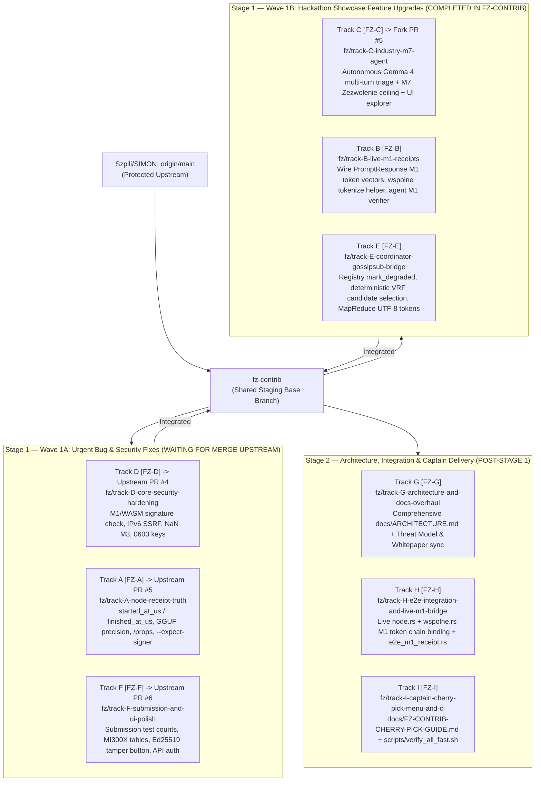

# 05 — Hackathon Roadmap & Canonical Track / Pull-Request Catalog

**Current Date:** 2026-10-15  
**Hackathon Deadline:** AMD Developer Hackathon: ACT III (Oct 18, 2026)  
**Goal:** Maximize judging scores across **Track 1 (Intelligent Industry)**, **Google Gemma Prize ($5,000)**, **AMD Prize ($5,000)**, **Vibe Generation Special Prize**, and **Evolus Business Agents Partner Track**, while delivering the full cryptographic verification suite, node truthfulness, and P2P coordination layers.

---

## 1. Upstream Pull Request Status on `https://github.com/Szpili/SIMON/`

To prevent repository spam and protect `Szpili/SIMON:main`, all tracks branch off **`fz-contrib`**, maintain 100% disjoint file ownership, and use atomic commits prefixed with `[FZ-<Track><N>]` so the Team Captain can either merge `fz-contrib` or cherry-pick individual fixes in seconds.

### Currently Open & Waiting for Merge on Upstream (`Szpili/SIMON`):
1. **[Upstream PR #4](https://github.com/Szpili/SIMON/pull/4) — Track D (`[FZ-D]`):** `fix(core,wasm): enforce M0 signature in M1/WASM, block IPv6-mapped SSRF, NaN logprobs, and non-object Cap JSON` (from `fz/track-D-core-security-hardening` -> `main`)
2. **[Upstream PR #5](https://github.com/Szpili/SIMON/pull/5) — Track A (`[FZ-A]`):** `fix(node,cli): populate real timestamps, dynamic precision, and --expect-signer verification` (from `fz/track-A-node-receipt-truth` -> `main`)
3. **[Upstream PR #6](https://github.com/Szpili/SIMON/pull/6) — Track F (`[FZ-F]`):** `fix(ui,docs,tools): reconcile submission tables, add live signature tamper button, and harden Python tools` (from `fz/track-F-submission-and-ui-polish` -> `main`)

*(Note: Upstream PR #1 is an independent research proposal from Josephsjr96; PR #2 and PR #3 were historical. Track letters `Track A` through `Track I` and commit tags `[FZ-A]` through `[FZ-I]` provide the authoritative, unambiguous cross-file identifiers.)*

---

## 2. Strategic Prioritization & Wave Architecture

---

## 3. Master Track Catalog (Tracks A through I)

| Track Code | Commit Tag | Dedicated Branch (`fz/track-*`) | Target PR Base | Live Upstream / Remote Status | Exclusive Target Files | What It Solves / Delivers |
| :--- | :--- | :--- | :--- | :--- | :--- | :--- |
| **Track D** | `[FZ-D]` | `fz/track-D-core-security-hardening` | `fz-contrib` / `main` | **[Upstream PR #4](https://github.com/Szpili/SIMON/pull/4)** | `crates/simon-core/src/**` `crates/simon-core/tests/**` `crates/simon-verify-wasm/src/lib.rs` | Enforces Ed25519 signature inside `Receipt::zweryfikuj_m1` (`BUG-04`), blocks IPv4-mapped IPv6 & ULA SSRF (`BUG-06`), rejects `NaN` logprobs and sorts `topk` in `m3.rs` (`BUG-15`), hardens `cap.rs` non-object JSON and 0600 file creation. |
| **Track A** | `[FZ-A]` | `fz/track-A-node-receipt-truth` | `fz-contrib` / `main` | **[Upstream PR #5](https://github.com/Szpili/SIMON/pull/5)** | `crates/simon-cli/src/node.rs` `crates/simon-cli/src/main.rs` | Captures real `started_at_us` and `finished_at_us` in live receipts (`BUG-01`), infers dynamic `Precision` from model name (`BUG-02`), detects `llama.cpp` runtime via `/props`, supports `llama-server` `/tokenize`, and adds `--expect-signer` offline check. |
| **Track F** | `[FZ-F]` | `fz/track-F-submission-and-ui-polish` | `fz-contrib` / `main` | **[Upstream PR #6](https://github.com/Szpili/SIMON/pull/6)** | `README.md` `docs/zgloszenie/LABLAB-SUBMISSION.md` `ui/src/routes/demo/+page.svelte` `ui/src/routes/network/+page.svelte` `ui/src/lib/components/NodePanel.svelte` `tools/simon-api/simon_api.py` `tools/simon-verifier/verifier_loop.py` `demo/app.py`, `demo/app.en.py` | Aligns test counts (187 Rust + 24 Python = 211) and completed MI300X tables (`BUG-16`), adds live Ed25519 signature tamper button to `/demo` (`BUG-14`), adds simulated topology badge to `/network` (`BUG-13`), hardens `simon_api.py` with M1 `proof_level` & optional `SIMON_API_KEY` auth (`BUG-10`). |
| **Track C** | `[FZ-C]` | `fz/track-C-industry-m7-agent` | `fz-contrib` | **Fork PR #5** (Integrated in `fz-contrib`) | `tools/simon-industry/**` `ui/src/lib/industry-run.json` `ui/src/routes/industry/+page.svelte` | Implements `agent_triage.py` autonomous multi-turn Gemma 4 26B-A4B tool-calling agent with strict M7 capability ceiling (`SIMON/GRANT-PARAMS/v1`) (`BUG-09`), and adds interactive WASM tamper & M7 `Zezwolenie` operator grant explorer to `/industry`. |
| **Track B** | `[FZ-B]` | `fz/track-B-live-m1-receipts` | `fz-contrib` | **Integrated in `fz-contrib`** | `crates/simon-harness/src/request_response.rs` `crates/simon-cli/src/wspolne.rs` `crates/simon-cli/src/agent.rs` `crates/simon-cli/src/node.rs` (3-line init) | Adds optional `tokenizer_hash`, `prompt_token_ids`, and `output_token_ids` to `PromptResponse` (`BUG-03`), implements `wspolne::tokenizuj_tekst` and default tokenizer hash helper, and automatically runs `zweryfikuj_m1` in `simon agent`. |
| **Track E** | `[FZ-E]` | `fz/track-E-coordinator-gossipsub-bridge` | `fz-contrib` | **Integrated in `fz-contrib`** | `crates/simon-node/src/lib.rs` `crates/simon-cli/src/coord.rs` `crates/simon-cli/src/mapreduce.rs` | Adds `mark_degraded`, `active_assignments`, and deterministic VRF candidate selection to `Registry` (`BUG-07`), wires `TOPIC_JOB_RESULT` and real VRF seed in `coord.rs`, and fixes `mapreduce.rs` UTF-8 token budgeting (`BUG-08`). |
| **Track G** | `[FZ-G]` | `fz/track-G-architecture-and-docs-overhaul` | `fz-contrib` | Stage 2 (Post-Stage 1) | `docs/ARCHITECTURE.md` `docs/THREAT-MODEL.md` `ROADMAP.md` `docs/whitepaper/SIMON-whitepaper-EN.md` | Authoritative Mermaid system architecture, data flows, and verification hierarchy documentation; aligns threat model with verifiable receipts vs active canary probing. |
| **Track H** | `[FZ-H]` | `fz/track-H-e2e-integration-and-live-m1-bridge` | `fz-contrib` | Stage 2 (Post-Stage 1) | `crates/simon-cli/src/node.rs` `crates/simon-cli/tests/e2e_m1_receipt.rs` | Bridges `node.rs` to `wspolne::tokenizuj_tekst` and populates `Receipt::z_wiazaniem_m1` live when backend supports `/tokenize`; adds comprehensive end-to-end integration test. |
| **Track I** | `[FZ-I]` | `fz/track-I-captain-cherry-pick-menu-and-ci` | `fz-contrib` | Stage 2 (Post-Stage 1) | `docs/FZ-CONTRIB-CHERRY-PICK-GUIDE.md` `scripts/verify_all_fast.sh` | Team Captain cherry-pick menu categorizing every atomic commit for 10-second cherry-picking; single-command fast verification runner. |
