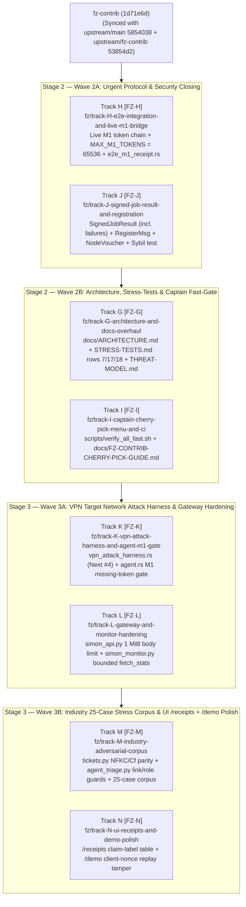

# 05 — Hackathon Roadmap & Canonical Track / Pull-Request Catalog

**Current Date:** 2026-10-16  
**Hackathon Deadline:** AMD Developer Hackathon: ACT III (Oct 18, 2026)  
**Baseline on `fz-contrib`:** `1d71e6d` (merges `upstream/main` `5854038` + `upstream/fz-contrib` `53854d2`)  
**Stage 1 Post-Mortem:** [`07_STAGE1_CAPTAIN_REVIEW_POSTMORTEM.md`](./07_STAGE1_CAPTAIN_REVIEW_POSTMORTEM.md)

---

## 1. Stage 1 Status (Merged Upstream in PR #8 + Captain Review Refinements)

All 6 Stage 1 tracks (`Tracks A, B, C, D, E, F`) were reviewed by the Team Captain (`Szpili`) and his Claude Opus 5.5 agent, refined across 22 commits, and merged into `Szpili/SIMON:main` via **PR #8 (`d108364`)** plus 5 additional commits on `upstream/fz-contrib` (`53854d2`) and 1 commit on `upstream/main` (`5854038`).

In [`docs/STRESS-TESTS.md`](file:///home/agent/SIMON/docs/STRESS-TESTS.md) (`53854d2`), the Captain established the **16-row VPN Stress & Edge-Case Table** and defined the explicit **4-item `## Next` queue**:
1. **Next #1:** Sign `JobResult` (failures too) with the node key; coordinator verifies before any state change. $\rightarrow$ **Track J (Stage 2, Wave 2A)**
2. **Next #2:** Wire live M1: node tokenizes prompt and output via the backend, sends ids with length caps. $\rightarrow$ **Track H (Stage 2, Wave 2A)**
3. **Next #3:** Signed node registration (keys and vouching for new nodes), then Sybil tests. $\rightarrow$ **Track J (Stage 2, Wave 2A)**
4. **Next #4:** A prepared target network for an outside tester (attack the connected nodes, report against this table). $\rightarrow$ **Track K (Stage 3, Wave 3A)**

---

## 2. Stage 2 & Stage 3 Wave Architecture (100% Disjoint Per-Stage File Scopes)

---

## 3. Master Track Catalog (Tracks A through N)

| Track Code | Stage / Wave | Commit Tag | Dedicated Branch (`fz/track-*`) | Target PR Base | Status | Exclusive Target Files | What It Solves / Delivers |
| :--- | :--- | :--- | :--- | :--- | :--- | :--- | :--- |
| **Track D** | Stage 1 (1A) | `[FZ-D]` | `fz/track-D-core-security-hardening` | `fz-contrib` | **Merged (`PR #8`)** | `crates/simon-core/**` `crates/simon-verify-wasm/**` | Ed25519 signature in `zweryfikuj_m1`, IPv4-mapped IPv6/CGNAT SSRF, `m3.rs` `NaN` & `simulated` check, `cap.rs` null args fix, `0600` keys. |
| **Track A** | Stage 1 (1A) | `[FZ-A]` | `fz/track-A-node-receipt-truth` | `fz-contrib` | **Merged (`PR #8`)** | `crates/simon-cli/src/node.rs` `crates/simon-cli/src/main.rs` | Real `started_at_us`/`finished_at_us`, honest `Precision::{Int8, Int4, Unknown}`, per-peer replay & rate limiter, `--expect-signer`. |
| **Track F** | Stage 1 (1A) | `[FZ-F]` | `fz/track-F-submission-and-ui-polish` | `fz-contrib` | **Merged (`PR #8`)** | `README.md`, `ui/**`, `tools/simon-api/**`, `demo/**` | Live `/demo` signature tamper, `/network` honest header, `simon_api.py` SHA-256 `hmac.compare_digest` & `503` + `Retry-After`. |
| **Track C** | Stage 1 (1B) | `[FZ-C]` | `fz/track-C-industry-m7-agent` | `fz-contrib` | **Merged (`PR #8`)** | `tools/simon-industry/**` `ui/src/routes/industry/**` | `agent_triage.py` with `rules.findings(row)[0]` lock, NFKC + `Cf` stripping, CSV cleaning, and 17-case `stress_corpus.json`. |
| **Track B** | Stage 1 (1B) | `[FZ-B]` | `fz/track-B-live-m1-receipts` | `fz-contrib` | **Merged (`PR #8`)** | `crates/simon-harness/**` `crates/simon-cli/src/agent.rs` | `PromptResponse` token fields, `poziom_sprawdzony`, client `order.nonce` binding, `signer_pinned` reporting. |
| **Track E** | Stage 1 (1B) | `[FZ-E]` | `fz/track-E-coordinator-gossipsub-bridge` | `fz-contrib` | **Merged (`PR #8`)** | `crates/simon-node/src/lib.rs` `crates/simon-cli/src/coord.rs` | Assigned-node `mark_degraded` check, `complete_job` on failure, deterministic VRF selection, `mapreduce.rs` UTF-8 budgeting. |
| **Track H** | **Stage 2 (2A)** | `[FZ-H]` | `fz/track-H-e2e-integration-and-live-m1-bridge` | `fz-contrib` | **Ready to Run** | `crates/simon-cli/src/wspolne.rs` `crates/simon-cli/src/node.rs` `crates/simon-cli/tests/e2e_m1_receipt.rs` | **`STRESS-TESTS.md` Next #2:** `MAX_M1_TOKENS = 65_536` cap, `WiazaniaM1` live token binding in `node.rs`, and in-process E2E test. |
| **Track J** | **Stage 2 (2A)** | `[FZ-J]` | `fz/track-J-signed-job-result-and-registration` | `fz-contrib` | **Ready to Run** | `crates/simon-node/src/lib.rs` `crates/simon-cli/src/coord.rs` | **`STRESS-TESTS.md` Next #1 & #3:** `SignedJobResult` (`SIMON/JOB-RESULT/v1`, failures too) + `RegisterMsg` & `NodeVoucher` (`SIMON/NODE-REGISTER/v1`, `SIMON/NODE-VOUCH/v1`) + Sybil tests. |
| **Track G** | **Stage 2 (2B)** | `[FZ-G]` | `fz/track-G-architecture-and-docs-overhaul` | `fz-contrib` | **Ready to Run** | `docs/ARCHITECTURE.md` `docs/STRESS-TESTS.md` `docs/THREAT-MODEL.md` `ROADMAP.md` `docs/whitepaper/SIMON-whitepaper-EN.md` | Mermaid architecture & claim hierarchy in `docs/ARCHITECTURE.md`, updates `STRESS-TESTS.md` rows 7/17/18, and aligns threat model & whitepaper. |
| **Track I** | **Stage 2 (2B)** | `[FZ-I]` | `fz/track-I-captain-cherry-pick-menu-and-ci` | `fz-contrib` | **Ready to Run** | `scripts/verify_all_fast.sh` `docs/FZ-CONTRIB-CHERRY-PICK-GUIDE.md` | One-command full-stack verification & Captain Guardrail runner (`verify_all_fast.sh`) + Stage 2 Captain Cherry-Pick Menu. |
| **Track K** | **Stage 3 (3A)** | `[FZ-K]` | `fz/track-K-vpn-attack-harness-and-agent-m1-gate` | `fz-contrib` | **Ready to Run** | `crates/simon-cli/src/agent.rs` `crates/simon-cli/tests/vpn_attack_harness.rs` | **`STRESS-TESTS.md` Next #4:** Prepared VPN target network attack harness (`vpn_attack_harness.rs`) + `agent.rs` rejection of Level 1 receipts missing token arrays. |
| **Track L** | **Stage 3 (3A)** | `[FZ-L]` | `fz/track-L-gateway-and-monitor-hardening` | `fz-contrib` | **Ready to Run** | `tools/simon-api/simon_api.py` `tools/simon-api/test_gateway.py` `tools/simon-monitor/simon_monitor.py` | Enforces 1 MiB body limit (`413`) and logs `signer_pinned` in `simon_api.py`; bounds `fetch_stats` read in `simon_monitor.py`; adds `--selfcheck` to both. |
| **Track M** | **Stage 3 (3B)** | `[FZ-M]` | `fz/track-M-industry-adversarial-corpus` | `fz-contrib` | **Ready to Run** | `tools/simon-industry/tickets.py` `tools/simon-industry/agent_triage.py` `tools/simon-industry/stress_corpus.json` | Applies `_znormalizuj` (NFKC + `Cf` stripping) to `tickets.py`, adds link/role/urgency checks to `agent_triage.py`, and expands `stress_corpus.json` from 17 to 25 cases. |
| **Track N** | **Stage 3 (3B)** | `[FZ-N]` | `fz/track-N-ui-receipts-and-demo-polish` | `fz-contrib` | **Ready to Run** | `ui/src/routes/receipts/+page.svelte` `ui/src/routes/demo/+page.svelte` | Adds Level 0 / Level 1 / M3 / M7 claim-label reference table to `/receipts` and adds a client-nonce replay tamper preset + `aria-pressed` semantics to `/demo`. |
