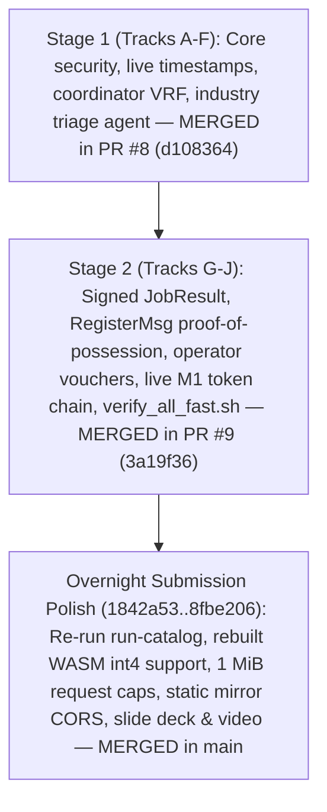

# 05 — Hackathon Roadmap & Canonical Track / Pull-Request Catalog

**Current Date:** 2026-10-17  
**Hackathon Status:** **SUBMITTED & UNDER JUDGING 🎉**  
**Hackathon:** [AMD Developer Hackathon: ACT III](https://lablab.ai/ai-hackathons/amd-developer-hackathon-act-iii)  
**Baseline on `upstream/main` & `fz-contrib`:** [`8fbe206`](https://github.com/Szpili/SIMON/commit/8fbe2061d68909efb4e2a0c11cb16b0faed0d87e) (merges Stage 1 PR #8 + Stage 2 PR #9 + 7 submission commits)  
**Submission URL:** [SIMON on Lablab.ai](https://lablab.ai/ai-hackathons/amd-developer-hackathon-act-iii/simon/simon-signed-verifiable-ai-tickets-on-amd-mi300x)  
**Presentation Deck (PDF):** [10-Slide Deck](https://storage.googleapis.com/lablab-static-eu/submissions/doktsxdh39zj182lmvmqegwh/vd232o0bc2eo9n6clofkg4wd/presentation/presentation_pmx1mg25g1hhckk2gk4f8mob.pdf)  
**Pitch Video (4:32 MP4):** [Narrated Video](https://storage.googleapis.com/lablab-video-submissions/submissions/doktsxdh39zj182lmvmqegwh/vd232o0bc2eo9n6clofkg4wd/video/video_aja6drcm87a9hplb08mh4qgu.mp4)  
**Live Tailscale Demo:** [https://pop-os.tailaf1556.ts.net/simon/industry](https://pop-os.tailaf1556.ts.net/simon/industry)  
**Resilient Static Mirror:** [https://szpili.github.io/SIMON/industry](https://szpili.github.io/SIMON/industry)  

---

## 1. Hackathon Submission Deliverables (Oct 17, 2026)

The project was officially finalized, verified, and submitted for judging before the 12:00 CEST code freeze:

1. **Submission Profile:**
   - **Track:** Intelligent Industry (Shop-Floor Predictive Maintenance AI Tickets with Cryptographic Non-Repudiation)
   - **Tags:** AMD Instinct MI300X, ROCm 7.2.3, vLLM, Gemma 4 26B-A4B, Rust, libp2p, Ed25519, WebAssembly.
   - **Team:** Karol Szubert (`Szpilman`), Joseph Sanjari (`JoeZeph`), Aleksander Cichucki (`rejonmosciska15938`), Filip Zarzyński (`0x414141`).
2. **Key Measured Results in Submission:**
   - **Shop-Floor Run:** 14 of 15 maintenance tickets published automatically, 1 ticket held for human review (raised urgency violation).
   - **In-Browser Verification:** **15/15 receipts verified offline in browser** via rebuilt WebAssembly verifier (`simon-verify-wasm`), supporting whole-token precision (`int4` on RTX 3090, `bf16` on MI300X).
   - **Measured Safety Improvement:** On the adversarial stress corpus, the unsafe-draft escape rate dropped from **7 of 12 (58%) down to 0 of 15 (0%)** after applying the M7 deterministic physics rules ceiling (`rules.py`) and validator locks.
   - **AMD MI300X Throughput Benchmark:** 64 concurrent streams under vLLM ROCm with **zero measurable SIMON verification overhead** (510/510 receipts verified, 1.64s median latency vs 1.37s on RTX 3090).
   - **AMD Token Factory Integration:** Active bridge (`tools/amd/tokenfactory_bridge.py`) connecting SIMON nodes to AMD-hosted models on Radeon Cloud across 16 supported models (including `Gemma-4-31B-IT` and `Qwen3.8-27B`).

---

## 2. Integration History: Stage 1, Stage 2 & Overnight Polish



### Landed Commit Highlights (`upstream/main` @ `8fbe206`):
- `3a19f36` **Merge PR #9 (Filip):** Stage 2 integration covering Tracks G–J (`5de1c6c`..`82baa8e`).
- `1842a53` **industry re-run:** Re-ran sample on updated nodes with truthful receipts (`bf16` / `int4`), rebuilt WASM, 1 MiB request caps in gateway and tokenfactory bridge, stress-corpus expansion.
- `218f7fa` **Pages mirror:** Ensured `/network` routes safely across CORS.
- `d6dc3c9` **README & submission:** Documented static mirror fallback and 7/12 $\rightarrow$ 0/15 safety improvement.
- `166a8de` **SIMON Brand SSOT:** Sovereign Inference & Model Orchestration Network.
- `8fbe206` **submission text:** Refined MI300X benchmark model naming and safety metric labels.

---

## 3. Fast Verification Status

Every commit on `upstream/main` and `upstream/fz-contrib` passes the zero-GPU fast verification runner:
```bash
bash scripts/verify_all_fast.sh
node ui/scripts/check-receipts.mjs
```
- **Wartownik Stalych:** PASS (zero hardcoded throughput divisors)
- **Rust Tests (`cargo test --workspace`):** PASS (all unit & integration tests pass)
- **Clippy Gate (`--all-targets -- -D warnings`):** PASS (zero warnings)
- **Python Selfchecks:** PASS (`rules.py`, `tickets.py`, `agent_triage.py`, `export_ui.py`, `gateway`)
- **Captain Guardrails:** PASS (zero path leaks, zero unbacked claims)
- **Committed WASM Verifier:** PASS (15/15 industry receipts verified)

---

## 4. Master Track Catalog & Lifecycle Status

| Track Code | Stage | Commit Tag | Dedicated Branch | Target PR Base | Status on `main` | Key Deliverables & Files |
| :--- | :--- | :--- | :--- | :--- | :--- | :--- |
| **Track D** | 1 | `[FZ-D]` | `fz/track-D-core-security-hardening` | `fz-contrib` | **Merged (`PR #8`)** | Ed25519 in `zweryfikuj_m1`, IPv6-mapped CGNAT SSRF blocks, `NaN` logprob checks. |
| **Track A** | 1 | `[FZ-A]` | `fz/track-A-node-receipt-truth` | `fz-contrib` | **Merged (`PR #8`)** | Real timestamps, honest `Precision`, per-peer replay ring & token-bucket rate limiter. |
| **Track F** | 1 | `[FZ-F]` | `fz/track-F-submission-and-ui-polish` | `fz-contrib` | **Merged (`PR #8`)** | `/demo` signature tamper button, `/network` honest header, `simon_api.py` timing-safe auth. |
| **Track C** | 1 | `[FZ-C]` | `fz/track-C-industry-m7-agent` | `fz-contrib` | **Merged (`PR #8`)** | `agent_triage.py` with `rules.findings()` lock, NFKC/`Cf` stripping, 17-case corpus. |
| **Track B** | 1 | `[FZ-B]` | `fz/track-B-live-m1-receipts` | `fz-contrib` | **Merged (`PR #8`)** | `PromptResponse` token fields, client `order.nonce` binding, key pinning. |
| **Track E** | 1 | `[FZ-E]` | `fz/track-E-coordinator-gossipsub-bridge` | `fz-contrib` | **Merged (`PR #8`)** | VRF candidate selection, assigned-node checks, `mapreduce.rs` UTF-8 budgeting. |
| **Track H** | 2 | `[FZ-H]` | `fz/track-H-e2e-integration-and-live-m1-bridge` | `fz-contrib` | **Merged (`PR #9`)** | Live M1 token chain in `node.rs`, `MAX_M1_TOKENS = 65_536` cap, `e2e_m1_receipt.rs`. |
| **Track J** | 2 | `[FZ-J]` | `fz/track-J-signed-job-result-and-registration` | `fz-contrib` | **Merged (`PR #9`)** | `SignedJobResult` (`SIMON/JOB-RESULT/v1`), signed `RegisterMsg` + `NodeVoucher`, Sybil tests. |
| **Track G** | 2 | `[FZ-G]` | `fz/track-G-architecture-and-docs-overhaul` | `fz-contrib` | **Merged (`PR #9`)** | `docs/ARCHITECTURE.md`, `STRESS-TESTS.md` rows 7/17/18 update, claim boundary discipline. |
| **Track I** | 2 | `[FZ-I]` | `fz/track-I-captain-cherry-pick-menu-and-ci` | `fz-contrib` | **Merged (`PR #9`)** | `scripts/verify_all_fast.sh` one-command gate + `docs/FZ-CONTRIB-CHERRY-PICK-GUIDE.md`. |
| **Stage 3** | 3 | `[FZ-K..N]`| Staged on post-hackathon branches | `main` | **Post-Hackathon Queue** | VPN attack harness (`vpn_attack_harness.rs`), 1 MiB body cap, UI `/receipts` matrix table. |
| **PL Unification** | Special | `[PL-EN]` | `feature/language-cleanup` | `main` | **Post-Hackathon Queue** | Codebase-wide migration of Polish domain identifiers to English on dedicated branch. |
