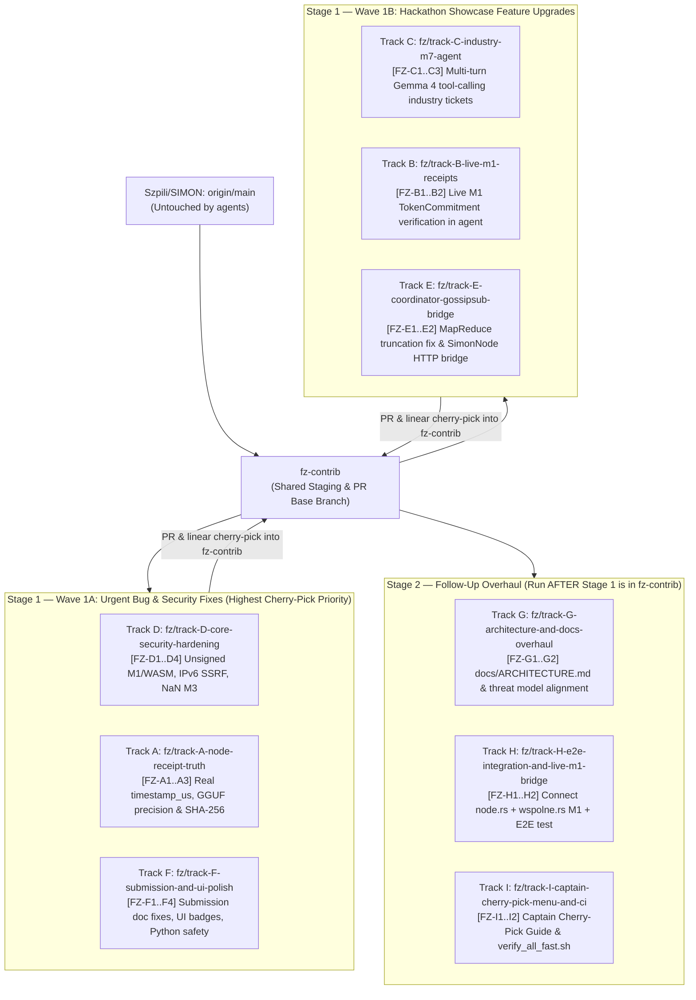

# Parallel Agent Orchestration Guide (`SIMPN_ARGON_HANDOWER`)

This repository is pre-configured as the **shared main Antigravity workspace** for parallel **Gemini 3.8 Flash High** coding agents working on [`Szpili/SIMON`](https://github.com/Szpili/SIMON).

---

## 1. Strategic Branch & Execution Order (`fz-contrib` Staging Architecture)

### Why We Use `fz-contrib` Instead of PRing Directly to `main`
1. **No Repo Spam / Zero Risk to `main`**: None of your agents ever push or open a PR against `main`. Every agent branches off **`fz-contrib`** into `fz/track-<X>-<slug>`, verifies zero merge conflicts, linearly integrates its commits onto `fz-contrib`, and targets **`fz-contrib`** as the PR base branch.
2. **Solving the Team Captain Review Bottleneck**:
   - Every commit on `fz-contrib` is atomic, non-breaking, and prefixed with `[FZ-<Track><N>]` (e.g. `[FZ-A1]`, `[FZ-D1]`, `[FZ-F1]`).
   - Each agent's `PR_SUBMISSION.md` (and Stage 2 Track I's `docs/FZ-CONTRIB-CHERRY-PICK-GUIDE.md`) provides a **Captain's Cherry-Pick Menu** with exact `git cherry-pick <sha>` commands.
   - Your Team Captain can either merge `fz-contrib` into `main` in one click, OR cherry-pick individual bugfixes in 10 seconds without taking anything they don't have time to review.



### Recommended Execution Order
- **Option 1 (Wave 1A First $\rightarrow$ Wave 1B Second $\rightarrow$ Stage 2 Third — Recommended)**:
  1. Launch **Tracks D, A, and F** in parallel first (~15–20 mins). These fix all critical security bugs (`BUG-04`, `BUG-06`, `BUG-15`), the `0 µs` timestamp & `"fp16"` receipt lies (`BUG-01`, `BUG-02`), and the `LABLAB-SUBMISSION.md` contradictions (`BUG-16`). Even if the hackathon ended 20 minutes later, the Captain will 100% cherry-pick these onto `main`.
  2. Launch **Tracks C, B, and E** in parallel next (~25 mins). Note that all 6 Stage 1 tracks (`A`–`F`) have **100% disjoint file scopes**, so you can also launch all 6 simultaneously if you have 6 agent slots!
  3. Once Stage 1 tracks (`A`–`F`) have finished and integrated into `fz-contrib`, launch **Stage 2 Tracks G, H, and I** in parallel (~15 mins) to wire the cross-file `node.rs` + `wspolne.rs` E2E test (`Track H`), overhaul `docs/ARCHITECTURE.md` (`Track G`), and generate the Captain's Cherry-Pick Guide (`Track I`).

---

## 2. Ready-to-Paste Prompts for Antigravity Agents

Open `/home/agent/SIMPN_ARGON_HANDOWER` as the workspace in Antigravity and paste the prompt for any track (`A`–`F` in Stage 1; `G`–`I` in Stage 2):

### Stage 1 Prompts (Can Run All 6 in Parallel, or Wave 1A `[D, A, F]` then Wave 1B `[C, B, E]`)

- **Track D (Urgent Core & WASM Security)**:
  ```text
  you are track D agent, please clone upstream repo to your dedicated subfolder in this workspace and start working on your assigned tasks on dedicated branch making sure commits are granular, logical and not breaking, then once you are finished and checked everything multiple times create a pull request with your task addressing any possible merge issues
  ```
- **Track A (Urgent Node Receipt Truthfulness)**:
  ```text
  you are track A agent, please clone upstream repo to your dedicated subfolder in this workspace and start working on your assigned tasks on dedicated branch making sure commits are granular, logical and not breaking, then once you are finished and checked everything multiple times create a pull request with your task addressing any possible merge issues
  ```
- **Track F (Urgent Submission Doc, UI & Python Fixes)**:
  ```text
  you are track F agent, please clone upstream repo to your dedicated subfolder in this workspace and start working on your assigned tasks on dedicated branch making sure commits are granular, logical and not breaking, then once you are finished and checked everything multiple times create a pull request with your task addressing any possible merge issues
  ```
- **Track C (Track 1 Intelligent Industry Gemma 4 M7 Agent)**:
  ```text
  you are track C agent, please clone upstream repo to your dedicated subfolder in this workspace and start working on your assigned tasks on dedicated branch making sure commits are granular, logical and not breaking, then once you are finished and checked everything multiple times create a pull request with your task addressing any possible merge issues
  ```
- **Track B (Live M1 Token Commitment Verification)**:
  ```text
  you are track B agent, please clone upstream repo to your dedicated subfolder in this workspace and start working on your assigned tasks on dedicated branch making sure commits are granular, logical and not breaking, then once you are finished and checked everything multiple times create a pull request with your task addressing any possible merge issues
  ```
- **Track E (P2P Coordinator HTTP Bridge & MapReduce Fix)**:
  ```text
  you are track E agent, please clone upstream repo to your dedicated subfolder in this workspace and start working on your assigned tasks on dedicated branch making sure commits are granular, logical and not breaking, then once you are finished and checked everything multiple times create a pull request with your task addressing any possible merge issues
  ```

### Stage 2 Prompts (Run AFTER Stage 1 Tracks A–F Finish)

- **Track G (Architecture & Documentation Overhaul)**:
  ```text
  you are track G agent, please clone upstream repo to your dedicated subfolder in this workspace and start working on your assigned tasks on dedicated branch making sure commits are granular, logical and not breaking, then once you are finished and checked everything multiple times create a pull request with your task addressing any possible merge issues
  ```
- **Track H (Live Node + Agent M1 E2E Integration)**:
  ```text
  you are track H agent, please clone upstream repo to your dedicated subfolder in this workspace and start working on your assigned tasks on dedicated branch making sure commits are granular, logical and not breaking, then once you are finished and checked everything multiple times create a pull request with your task addressing any possible merge issues
  ```
- **Track I (Captain Cherry-Pick Menu & Fast Full-Stack Verifier)**:
  ```text
  you are track I agent, please clone upstream repo to your dedicated subfolder in this workspace and start working on your assigned tasks on dedicated branch making sure commits are granular, logical and not breaking, then once you are finished and checked everything multiple times create a pull request with your task addressing any possible merge issues
  ```
