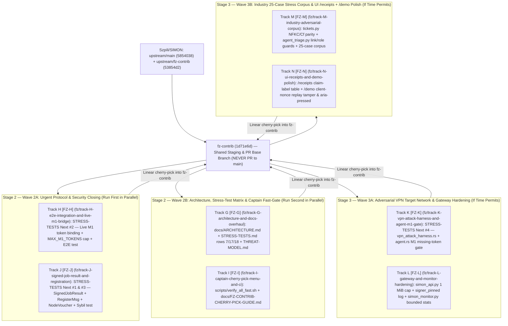

# Parallel Agent Orchestration Guide (`SIMPN_ARGON_HANDOWER`)

This repository is pre-configured as the **shared main Antigravity workspace** for parallel **Gemini 3.8 Flash High** coding agents working on [`Szpili/SIMON`](https://github.com/Szpili/SIMON).

---

## 0. Post-Mortem Lesson from Stage 1 (Why Stage 2 & Stage 3 Are Built Differently)

When the Team Captain (`Szpili`) and his Claude Opus 5.5 agent reviewed and merged Stage 1 (`fz-contrib` $\rightarrow$ `main` in PR #8 `d108364`, plus 5 follow-up commits on `fz-contrib` through `53854d2`), they made **22 corrective commits** documented in [`07_STAGE1_CAPTAIN_REVIEW_POSTMORTEM.md`](../07_STAGE1_CAPTAIN_REVIEW_POSTMORTEM.md).

We have baked all 7 lessons from those 22 commits directly into:
1. **[`.agents/skills/simon-captain-review-guardrails/SKILL.md`](../.agents/skills/simon-captain-review-guardrails/SKILL.md)** (mandatory reading for every agent).
2. **[`.agents/skills/simon-verify-suite/scripts/verify_track.sh`](../.agents/skills/simon-verify-suite/scripts/verify_track.sh)** (automated Pass 2 blocks workspace path leaks, banned overclaims, fake signatures, and runs `cargo clippy --all-targets -- -D warnings` + all Python `.selfcheck()` suites).
3. **100% alignment with the Captain's explicit `## Next` list in [`docs/STRESS-TESTS.md`](file:///home/agent/SIMON/docs/STRESS-TESTS.md)**:
   - `Next #1` (Sign `JobResult` including failures) + `Next #3` (Signed node registration & vouching + Sybil tests) $\rightarrow$ **Stage 2, Wave 2A (`Track J`)**
   - `Next #2` (Wire live M1 token chain with `MAX_M1_TOKENS = 65_536` caps) $\rightarrow$ **Stage 2, Wave 2A (`Track H`)**
   - `Next #4` (Prepared VPN target network attack harness reporting against `docs/STRESS-TESTS.md`) $\rightarrow$ **Stage 3, Wave 3A (`Track K`)**

---

## 1. Strategic Branch & Wave Execution Order (`fz-contrib` Staging Architecture)



### Recommended Wave Execution Order
1. **Stage 2 — Wave 2A (`Tracks H & J` in parallel — ~15 mins)**:
   - Closes the Captain's top 3 `docs/STRESS-TESTS.md` `## Next` items (`#1` Signed `JobResult`, `#2` Live M1 with `MAX_M1_TOKENS`, `#3` Signed `RegisterMsg` + `NodeVoucher` + Sybil tests).
2. **Stage 2 — Wave 2B (`Tracks G & I` in parallel — ~10 mins)**:
   - Updates `docs/STRESS-TESTS.md` rows 7/17/18, creates `docs/ARCHITECTURE.md`, adds `scripts/verify_all_fast.sh`, and generates `docs/FZ-CONTRIB-CHERRY-PICK-GUIDE.md` for the Captain.
   - *(Note: All 4 Stage 2 tracks `H, J, G, I` have 100% disjoint file scopes, so if you want to run all 4 simultaneously, they will never conflict! Running `2A` then `2B` simply lets Track I include the exact commit SHAs of `H` and `J` in `FZ-CONTRIB-CHERRY-PICK-GUIDE.md`.)*
3. **Stage 3 — Wave 3A (`Tracks K & L` in parallel — ~15 mins, if time permits)**:
   - Delivers `docs/STRESS-TESTS.md` `Next #4` (`crates/simon-cli/tests/vpn_attack_harness.rs`), closes the `agent.rs` M1 missing-token downgrade gap, and hardens `simon_api.py` + `simon_monitor.py`.
4. **Stage 3 — Wave 3B (`Tracks M & N` in parallel — ~15 mins, if time permits)**:
   - Unifies NFKC/`Cf` and link/role/urgency checks across `tickets.py` and `agent_triage.py`, expands `stress_corpus.json` from 17 to 25 cases, and polishes `/receipts` + `/demo`.
   - *(All 4 Stage 3 tracks `K, L, M, N` also have 100% disjoint file scopes!)*

---

## 2. Ready-to-Paste Prompts for Antigravity Agents (Stage 2 & Stage 3)

Open `/home/agent/SIMPN_ARGON_HANDOWER` as the workspace in Antigravity and paste the prompt for any track:

### Stage 2 — Wave 2A Prompts (Launch Together in Parallel)

- **Track H (Live M1 Token Chain Bridge + `MAX_M1_TOKENS` Cap + E2E Test)**:
  ```text
  you are track H agent, please clone upstream repo to your dedicated subfolder in this workspace and start working on your assigned tasks on dedicated branch making sure commits are granular, logical and not breaking, then once you are finished and checked everything multiple times create a pull request with your task addressing any possible merge issues
  ```
- **Track J (Signed `JobResult` + Signed `RegisterMsg` & Operator Vouching + Sybil Tests)**:
  ```text
  you are track J agent, please clone upstream repo to your dedicated subfolder in this workspace and start working on your assigned tasks on dedicated branch making sure commits are granular, logical and not breaking, then once you are finished and checked everything multiple times create a pull request with your task addressing any possible merge issues
  ```

### Stage 2 — Wave 2B Prompts (Launch Together After Wave 2A, or in Parallel with 2A)

- **Track G (Architecture Diagrams & `STRESS-TESTS.md` Rows 7/17/18 Alignment)**:
  ```text
  you are track G agent, please clone upstream repo to your dedicated subfolder in this workspace and start working on your assigned tasks on dedicated branch making sure commits are granular, logical and not breaking, then once you are finished and checked everything multiple times create a pull request with your task addressing any possible merge issues
  ```
- **Track I (Captain Fast Verification Script `verify_all_fast.sh` & Cherry-Pick Guide)**:
  ```text
  you are track I agent, please clone upstream repo to your dedicated subfolder in this workspace and start working on your assigned tasks on dedicated branch making sure commits are granular, logical and not breaking, then once you are finished and checked everything multiple times create a pull request with your task addressing any possible merge issues
  ```

---

### Stage 3 — Wave 3A Prompts (Launch Together After Stage 2)

- **Track K (`STRESS-TESTS.md` Next #4 VPN Attack Harness & Agent M1 Gate)**:
  ```text
  you are track K agent, please clone upstream repo to your dedicated subfolder in this workspace and start working on your assigned tasks on dedicated branch making sure commits are granular, logical and not breaking, then once you are finished and checked everything multiple times create a pull request with your task addressing any possible merge issues
  ```
- **Track L (OpenAI Gateway 1 MiB Cap & Network Monitor Hardening)**:
  ```text
  you are track L agent, please clone upstream repo to your dedicated subfolder in this workspace and start working on your assigned tasks on dedicated branch making sure commits are granular, logical and not breaking, then once you are finished and checked everything multiple times create a pull request with your task addressing any possible merge issues
  ```

### Stage 3 — Wave 3B Prompts (Launch Together After Wave 3A, or All 4 Stage 3 Tracks in Parallel)

- **Track M (Industry 25-Case Adversarial Stress Corpus & NFKC/Link Parity)**:
  ```text
  you are track M agent, please clone upstream repo to your dedicated subfolder in this workspace and start working on your assigned tasks on dedicated branch making sure commits are granular, logical and not breaking, then once you are finished and checked everything multiple times create a pull request with your task addressing any possible merge issues
  ```
- **Track N (UI `/receipts` Claim-Label Matrix & `/demo` Nonce Replay Tamper)**:
  ```text
  you are track N agent, please clone upstream repo to your dedicated subfolder in this workspace and start working on your assigned tasks on dedicated branch making sure commits are granular, logical and not breaking, then once you are finished and checked everything multiple times create a pull request with your task addressing any possible merge issues
  ```
