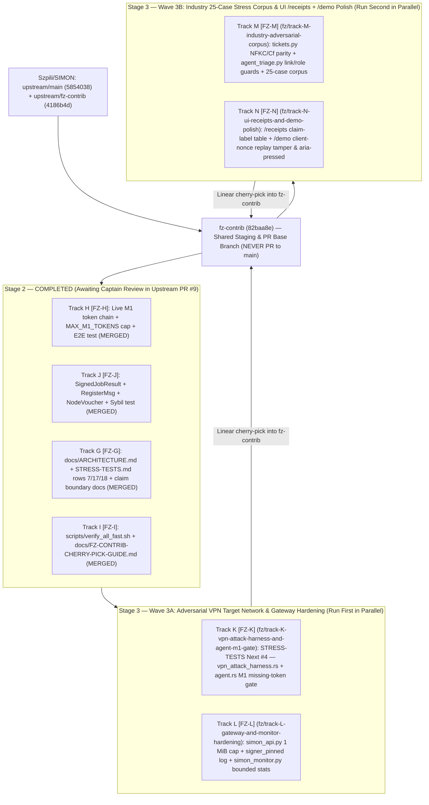

# Parallel Agent Orchestration Guide (`SIMPN_ARGON_HANDOWER`)

This repository is pre-configured as the **shared main Antigravity workspace** for parallel **Gemini 3.8 Flash High** coding agents working on [`Szpili/SIMON`](https://github.com/Szpili/SIMON).

---

## 0. Current Status & Baseline: Stage 2 Completed in PR #9, Stage 3 Ready to Run

* **Base Branch:** `fz-contrib` at **`82baa8e`** (includes all Stage 1 + Stage 2 commits).
* **Upstream Stage 2 PR:** [Szpili/SIMON#9](https://github.com/Szpili/SIMON/pull/9) (`fz-contrib` $\rightarrow$ `main`, 12 commits, mergeable, zero conflicts).
* **Fast Verification Command:** `bash scripts/verify_all_fast.sh` (passes all 6 suites in ~35s).
* **Next Active Wave:** **Stage 3 (Waves 3A & 3B: Tracks K, L, M, N)** running off `82baa8e` on `fz-contrib`.

---

## 1. Strategic Branch & Wave Execution Order (`fz-contrib` Staging Architecture)



### Wave Execution Order for Stage 3
1. **Stage 3 — Wave 3A (`Tracks K & L` in parallel — ~15 mins)**:
   - Delivers `docs/STRESS-TESTS.md` `Next #4` (`crates/simon-cli/tests/vpn_attack_harness.rs`), closes the `agent.rs` M1 missing-token downgrade gap, and hardens `simon_api.py` + `simon_monitor.py`.
2. **Stage 3 — Wave 3B (`Tracks M & N` in parallel — ~15 mins)**:
   - Unifies NFKC/`Cf` and link/role/urgency checks across `tickets.py` and `agent_triage.py`, expands `stress_corpus.json` from 17 to 25 cases, and polishes `/receipts` + `/demo`.
   - *(All 4 Stage 3 tracks `K, L, M, N` have 100% disjoint file scopes and can also be launched simultaneously if desired!)*

---

## 2. Ready-to-Paste Prompts for Antigravity Agents (Stage 3 Active Wave)

Open `/home/agent/SIMPN_ARGON_HANDOWER` as the workspace in Antigravity and paste the prompt for any Stage 3 track:

### Stage 3 — Wave 3A Prompts (Launch Together in Parallel)

- **Track K (`STRESS-TESTS.md` Next #4 VPN Attack Harness & Agent M1 Gate)**:
  ```text
  you are track K agent, please clone upstream repo to your dedicated subfolder in this workspace and start working on your assigned tasks on dedicated branch making sure commits are granular, logical and not breaking, then once you are finished and checked everything multiple times create a pull request with your task addressing any possible merge issues
  ```
- **Track L (OpenAI Gateway 1 MiB Cap & Network Monitor Hardening)**:
  ```text
  you are track L agent, please clone upstream repo to your dedicated subfolder in this workspace and start working on your assigned tasks on dedicated branch making sure commits are granular, logical and not breaking, then once you are finished and checked everything multiple times create a pull request with your task addressing any possible merge issues
  ```

### Stage 3 — Wave 3B Prompts (Launch Together After Wave 3A, or All 4 Stage 3 Tracks in Parallel)

- **Track M (Industry 25-Case Adversarial Stress Corpus & NFKC/Link Parity)**:
  ```text
  you are track M agent, please clone upstream repo to your dedicated subfolder in this workspace and start working on your assigned tasks on dedicated branch making sure commits are granular, logical and not breaking, then once you are finished and checked everything multiple times create a pull request with your task addressing any possible merge issues
  ```
- **Track N (UI `/receipts` Claim-Label Matrix & `/demo` Nonce Replay Tamper)**:
  ```text
  you are track N agent, please clone upstream repo to your dedicated subfolder in this workspace and start working on your assigned tasks on dedicated branch making sure commits are granular, logical and not breaking, then once you are finished and checked everything multiple times create a pull request with your task addressing any possible merge issues
  ```

---

## 3. Reference: Stage 2 Completed Deliverables (`Tracks H, J, G, I`)

All Stage 2 tracks completed cleanly and are integrated on `fz-contrib` (`82baa8e`):
* **Track H:** `crates/simon-cli/src/wspolne.rs`, `crates/simon-cli/src/node.rs`, `crates/simon-cli/tests/e2e_m1_receipt.rs`
* **Track J:** `crates/simon-node/src/lib.rs`, `crates/simon-cli/src/coord.rs`
* **Track G:** `docs/ARCHITECTURE.md`, `docs/STRESS-TESTS.md`, `docs/THREAT-MODEL.md`, `ROADMAP.md`
* **Track I:** `scripts/verify_all_fast.sh`, `docs/FZ-CONTRIB-CHERRY-PICK-GUIDE.md`
