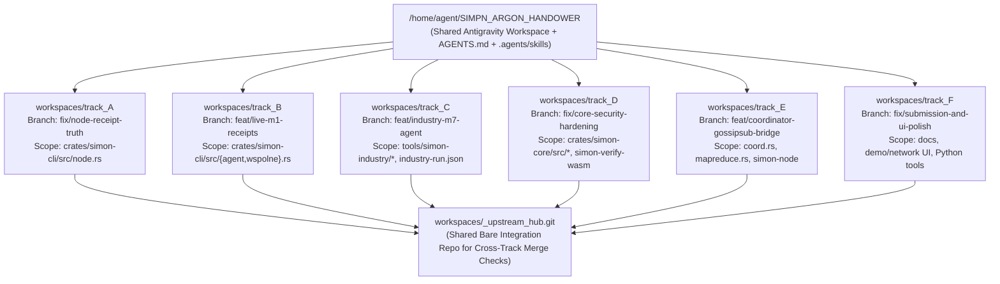

# Parallel Agent Orchestration Guide (`SIMPN_ARGON_HANDOWER`)

This repository is pre-configured as the **shared main Antigravity workspace** for 6 parallel **Gemini 3.8 Flash High** coding agents (`Track A` through `Track F`).

Because this repository includes:
- Root [`AGENTS.md`](file:///home/agent/SIMPN_ARGON_HANDOWER/AGENTS.md) (automatically loaded by Antigravity for every agent spawned in this workspace)
- 5 specialized workspace skills in `.agents/skills/`:
  - [`simon-track-init`](file:///home/agent/SIMPN_ARGON_HANDOWER/.agents/skills/simon-track-init/SKILL.md) (`init_track.sh`)
  - [`simon-crypto-and-protocol`](file:///home/agent/SIMPN_ARGON_HANDOWER/.agents/skills/simon-crypto-and-protocol/SKILL.md)
  - [`simon-industry-and-ui`](file:///home/agent/SIMPN_ARGON_HANDOWER/.agents/skills/simon-industry-and-ui/SKILL.md)
  - [`simon-verify-suite`](file:///home/agent/SIMPN_ARGON_HANDOWER/.agents/skills/simon-verify-suite/SKILL.md) (`verify_track.sh`)
  - [`simon-pr-delivery`](file:///home/agent/SIMPN_ARGON_HANDOWER/.agents/skills/simon-pr-delivery/SKILL.md) (`prepare_and_create_pr.py`)

you can spawn all 6 agents concurrently in Antigravity with `/home/agent/SIMPN_ARGON_HANDOWER` as their workspace using a single short prompt per agent.

---

## 1. Ready-to-Paste Prompts for Antigravity Agents

Open 6 agent sessions in `/home/agent/SIMPN_ARGON_HANDOWER` and paste the corresponding prompt:

### Track A Agent (`PR-1: fix/node-receipt-truth`)
```text
you are track A agent, please clone upstream repo to your dedicated subfolder in this workspace and start working on your assigned tasks on dedicated branch making sure commits are granular, logical and not breaking, then once you are finished and checked everything multiple times create a pull request with your task addressing any possible merge issues
```

### Track B Agent (`PR-2: feat/live-m1-receipts`)
```text
you are track B agent, please clone upstream repo to your dedicated subfolder in this workspace and start working on your assigned tasks on dedicated branch making sure commits are granular, logical and not breaking, then once you are finished and checked everything multiple times create a pull request with your task addressing any possible merge issues
```

### Track C Agent (`PR-3: feat/industry-m7-agent`)
```text
you are track C agent, please clone upstream repo to your dedicated subfolder in this workspace and start working on your assigned tasks on dedicated branch making sure commits are granular, logical and not breaking, then once you are finished and checked everything multiple times create a pull request with your task addressing any possible merge issues
```

### Track D Agent (`PR-4: fix/core-security-hardening`)
```text
you are track D agent, please clone upstream repo to your dedicated subfolder in this workspace and start working on your assigned tasks on dedicated branch making sure commits are granular, logical and not breaking, then once you are finished and checked everything multiple times create a pull request with your task addressing any possible merge issues
```

### Track E Agent (`PR-5: feat/coordinator-gossipsub-bridge`)
```text
you are track E agent, please clone upstream repo to your dedicated subfolder in this workspace and start working on your assigned tasks on dedicated branch making sure commits are granular, logical and not breaking, then once you are finished and checked everything multiple times create a pull request with your task addressing any possible merge issues
```

### Track F Agent (`PR-6: fix/submission-and-ui-polish`)
```text
you are track F agent, please clone upstream repo to your dedicated subfolder in this workspace and start working on your assigned tasks on dedicated branch making sure commits are granular, logical and not breaking, then once you are finished and checked everything multiple times create a pull request with your task addressing any possible merge issues
```

---

## 2. How Isolation & Zero Merge Conflicts Are Enforced



1. **Subfolder Isolation**: Each agent clones `https://github.com/Szpili/SIMON.git` into `workspaces/track_<X>` (git-ignored by the parent `SIMPN_ARGON_HANDOWER` repo so agents never dirty the handover repository).
2. **Automated Scope Gate (`verify_track.sh`)**: Before finishing, each agent runs `.agents/skills/simon-verify-suite/scripts/verify_track.sh <TRACK> --final`, which fails immediately if any file outside that Track's exclusive ownership was modified.
3. **Cross-Track Merge Verification (`prepare_and_create_pr.py`)**: Each agent pushes its finished branch to `workspaces/_upstream_hub.git` under an exclusive `flock` and runs `git merge-tree --write-tree` against `origin/main` and against every other completed Track branch in the hub, writing the full PR report and portable `.bundle` to `parallel_agents/track_<X>_*/PR_SUBMISSION.md`.
